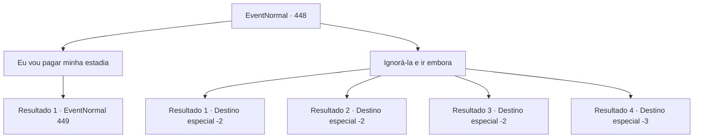

# Eventos normais · 448

[Índice da tabela](index.md) · [Índice geral](../index.md)

ID: `pt:EventNormal:448` · Fonte: `EventNormal4` · Versão: 1.2.47.

Mapeamento estático dos arquivos; a disponibilidade e a execução dependem do estado da run.

## Texto do evento

Você não conseguiu encontrar 'Rahiv', mas suas viagens o levaram de volta a Belo, a cidade litorânea. Ao contrário da última vez que você esteve aqui, a cidade está sendo banhada pela luz do sol. Era como se fosse uma cidade completamente diferente. Ao entrar na pousada, você percebe algo peculiar - o estalajadeiro e Laurent não estão em lugar algum. Você decide sentar e esperar até que o estalajadeiro volte. 

 Depois de algum tempo, cansado de esperar e se levantando para sair, o estalajadeiro entra na pousada com uma cesta cheia de pães. Sua cabeça e ombros estão cobertos de neve. 

 "Oh, peço desculpas... Tem estado quente nos últimos dias, e agora estamos com essa tempestade de neve de repente... Espero que você não tenha esperado muito."

 Ela larga a cesta meio congelada e continua. 

 "Indo para fora, você estava? Eu não faria isso se fosse você. Não até que a brisa do mar afaste a rajada das montanhas."

 Você move as cortinas e olha para fora. Tudo ao redor da pousada ficou branco por causa da neve.

## Dados de entrada

```json
{
  "id": 448,
  "grade": 2,
  "place": "",
  "required": "5_296_1"
}
```

## Mapa das escolhas



## Escolhas e resultados

### Escolha 1

Eu vou pagar minha estadia

Requisitos e outros campos da escolha:

```json
{
  "required": ""
}
```

#### Resultado 1.1

Você decide ficar na pousada até que a tempestade de neve termine. Você pergunta à estalajadeira quanto custaria uma estadia, mas ela balança a cabeça e responde. 

 "Não há necessidade. Parece que o deus das montanhas congeladas quer que você fique em Belo. Ou talvez alguém nesta cidade precise de sua ajuda..."

 O estalajadeiro olha para você e continua. 

 "Por exemplo, um estalajadeiro cujo funcionário desapareceu..."

 

Continuação registrada: [Evento 449](0449.md) na mesma tabela.

```json
{
  "required": "",
  "chance": "1",
  "nextEvent": 449,
  "type": 2,
  "reward": ""
}
```

### Escolha 2

Ignorá-la e ir embora

Requisitos e outros campos da escolha:

```json
{
  "required": ""
}
```

#### Resultado 2.1

Você vai para fora, para o mundo branco. Vento frio e neve obstruem seu caminho, mas não são suficientes para parar seus passos. Você caminha pela ira da natureza e consegue escapar da tempestade de neve somente depois de muito tempo.

Continuação registrada: [Destino especial `-2`](../destinos-especiais.md).

```json
{
  "required": "",
  "chance": "1|0_13_1",
  "nextEvent": -2,
  "type": 0,
  "reward": "5_296_9"
}
```

#### Resultado 2.2

Você vai para fora, para o mundo branco. Vento frio e neve obstruem seu caminho, mas não são suficientes para parar seus passos. Você caminha pela ira da natureza e consegue escapar da tempestade de neve somente depois de muito tempo.

Continuação registrada: [Destino especial `-2`](../destinos-especiais.md).

```json
{
  "required": "20_8_2",
  "chance": "1|0_13_1",
  "nextEvent": -2,
  "type": 0,
  "reward": "5_296_9"
}
```

#### Resultado 2.3

Você vai para fora, para o mundo branco. Vento frio e neve obstruem seu caminho. Infelizmente, você perde a noção de onde está na tempestade de neve. Quando você sai da tempestade de neve, sente dificuldade ao sair da hipotermia.

Continuação registrada: [Destino especial `-2`](../destinos-especiais.md).

```json
{
  "required": "1_0_2",
  "chance": "24",
  "nextEvent": -2,
  "type": 1,
  "reward": "0_0_-1"
}
```

#### Resultado 2.4

Você vai para fora, para o mundo branco. O vento frio e a neve obstruem seu caminho e, antes que você perceba, seu corpo congela completamente.

Continuação registrada: [Destino especial `-3`](../destinos-especiais.md).

```json
{
  "required": "2_0_2",
  "chance": "24",
  "nextEvent": -3,
  "type": 1,
  "reward": "0_0_-1"
}
```

## Referências que chegam a este evento

Nenhum `nextEvent` positivo da mesma tabela aponta para este nó. Isso não prova que seja inacessível: sorteio e estado de história podem selecioná-lo.

