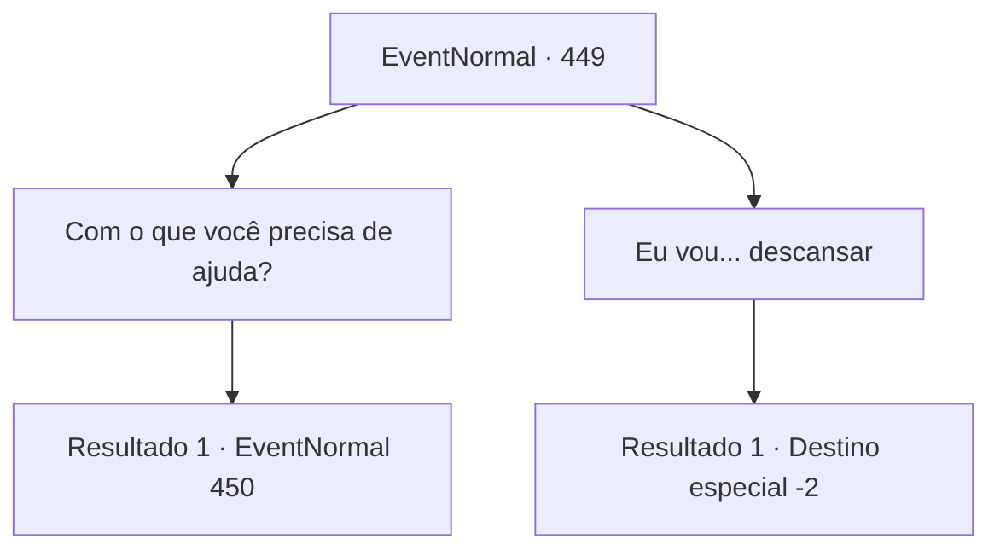

# Eventos normais · 449

[Índice da tabela](index.md) · [Índice geral](../index.md)

ID: `pt:EventNormal:449` · Fonte: `EventNormal4` · Versão: 1.2.47.

Mapeamento estático dos arquivos; a disponibilidade e a execução dependem do estado da run.

## Texto do evento

*Sem texto no arquivo.*

## Dados de entrada

```json
{
  "id": 449,
  "grade": 1,
  "place": "",
  "required": ""
}
```

## Mapa das escolhas



## Escolhas e resultados

### Escolha 1

Com o que você precisa de ajuda?

Requisitos e outros campos da escolha:

```json
{
  "required": ""
}
```

#### Resultado 1.1

O estalajadeiro responde alegremente. 

 "Eu sabia! Eu tinha certeza de que posso pedir sua ajuda, aventureiro. Na verdade, mandei Laurent fazer um pequeno recado, e ela ainda não voltou. Foi uma tarefa simples, não deve demorar tanto... Você poderia, por favor, procurá-la? Temo que algo ruim tenha acontecido com ela, nesta tempestade de neve."

 Você veste sua jaqueta e se prepara para sair. Então, o estalajadeiro para você e lhe entrega uma xícara de chá quente. 

 "Por favor. Isso vai te ajudar contra o frio."

 Você faz o que ela diz, bebendo o chá em um gole. Você sente o calor sendo produzido de dentro do seu corpo. Você abre a porta e sai da pousada.

Continuação registrada: [Evento 450](0450.md) na mesma tabela.

```json
{
  "required": "",
  "chance": "1",
  "nextEvent": 450,
  "type": 2,
  "reward": ""
}
```

### Escolha 2

Eu vou... descansar

Requisitos e outros campos da escolha:

```json
{
  "required": ""
}
```

#### Resultado 2.1

Você diz a ela que você só quer descansar. A estalajadeira responde bastante desapontada, prepara sua jaqueta e sai. Ela provavelmente foi procurar Laurent. Mas isso não é da sua conta. Você entra em uma sala vazia e fecha os olhos. 

 No dia seguinte, você abre a porta e sai do seu quarto. A tempestade de neve acabou e toda a cidade está colorida de branco. Por alguma razão, o estalajadeiro não voltou. Você sai da pousada.

Continuação registrada: [Destino especial `-2`](../destinos-especiais.md).

```json
{
  "required": "",
  "chance": "1",
  "nextEvent": -2,
  "type": 2,
  "reward": "5_296_9|0_0_1|0_1_1"
}
```

## Referências que chegam a este evento

- [Evento 448 · escolha 1 · resultado 1](0448.md#escolha-1)
