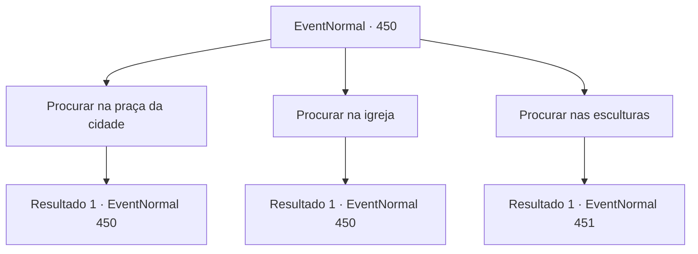

# Eventos normais · 450

[Índice da tabela](index.md) · [Índice geral](../index.md)

ID: `pt:EventNormal:450` · Fonte: `EventNormal4` · Versão: 1.2.47.

Mapeamento estático dos arquivos; a disponibilidade e a execução dependem do estado da run.

## Texto do evento

*Sem texto no arquivo.*

## Dados de entrada

```json
{
  "id": 450,
  "grade": 1,
  "place": "",
  "required": ""
}
```

## Mapa das escolhas



## Escolhas e resultados

### Escolha 1

Procurar na praça da cidade

Requisitos e outros campos da escolha:

```json
{
  "required": "5_300_0"
}
```

#### Resultado 1.1

Você vai para a praça da cidade. A praça está cheia de esculturas de gelo quebradas, e as fontes também estão congeladas. Mas você não consegue encontrar Laurent. Na verdade, você não pode sentir nenhuma forma de vida neste lugar. Você decide procurar em outro lugar.

Continuação registrada: [Evento 450](0450.md) na mesma tabela.

```json
{
  "required": "",
  "chance": "1",
  "nextEvent": 450,
  "type": 2,
  "reward": "5_300_1"
}
```

### Escolha 2

Procurar na igreja

Requisitos e outros campos da escolha:

```json
{
  "required": "5_301_0"
}
```

#### Resultado 2.1

Você vai para a igreja nas colinas. Dentro da igreja há vários padres e seguidores religiosos, cada um murmurando orações. Mas Laurent não está aqui. Você decide procurar em outro lugar.

Continuação registrada: [Evento 450](0450.md) na mesma tabela.

```json
{
  "required": "",
  "chance": "1",
  "nextEvent": 450,
  "type": 2,
  "reward": "5_301_1"
}
```

### Escolha 3

Procurar nas esculturas

Requisitos e outros campos da escolha:

```json
{
  "required": ""
}
```

#### Resultado 3.1

Você vai para o lugar onde estão as esculturas de gelo de Lauren. Mas enquanto você está flutuando na neve, você tropeça em alguma coisa e cai. É o que resta de uma escultura de gelo, depois que a maior parte derreteu. Aparentemente as esculturas não suportaram a luz do sol e derreteram. Então, você ouve a voz de uma mulher não muito longe de você. É Laurent. Ela está deitada ao lado da escultura de seu irmão, chorando.

Continuação registrada: [Evento 451](0451.md) na mesma tabela.

```json
{
  "required": "",
  "chance": "1",
  "nextEvent": 451,
  "type": 2,
  "reward": ""
}
```

## Referências que chegam a este evento

- [Evento 449 · escolha 1 · resultado 1](0449.md#escolha-1)
- [Evento 450 · escolha 1 · resultado 1](0450.md#escolha-1)
- [Evento 450 · escolha 2 · resultado 1](0450.md#escolha-2)
