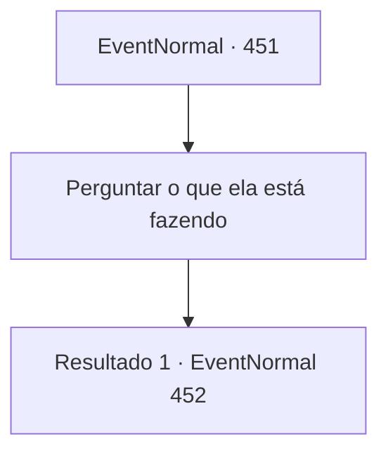

# Eventos normais · 451

[Índice da tabela](index.md) · [Índice geral](../index.md)

ID: `pt:EventNormal:451` · Fonte: `EventNormal4` · Versão: 1.2.47.

Mapeamento estático dos arquivos; a disponibilidade e a execução dependem do estado da run.

## Texto do evento

*Sem texto no arquivo.*

## Dados de entrada

```json
{
  "id": 451,
  "grade": 1,
  "place": "",
  "required": ""
}
```

## Mapa das escolhas



## Escolhas e resultados

### Escolha 1

Perguntar o que ela está fazendo

Requisitos e outros campos da escolha:

```json
{
  "required": ""
}
```

#### Resultado 1.1

Você pergunta a Laurent o que ela está fazendo. Mas ela não se move um centímetro. Ela continua tocando a escultura. Surpreendentemente, a escultura de seu irmão ainda está intacta. A luz do sol não fez nada com o gelo. Você se pergunta como isso é possível. 

 "....Eu sei. Eu sei onde meu irmão está."

 A julgar pela temperatura do corpo, ela está aqui há muito tempo. Suas mãos estão geladas e as lágrimas congelam assim que escorrem de seus olhos. 

 "Sua alma... está nesta escultura. Ele... ele... vagou pela vida após a morte... e voltou aqui."

 Ela dá um tapinha na escultura de gelo com as mãos, soluçando. 

 "*soluço*.... Tudo que eu queria de você... era voltar em segurança!! Por que... por que você... por que..."

 Ela continua a chorar e chorar, antes de cair em seus braços.

Continuação registrada: [Evento 452](0452.md) na mesma tabela.

```json
{
  "required": "",
  "chance": "1",
  "nextEvent": 452,
  "type": 2,
  "reward": ""
}
```

## Referências que chegam a este evento

- [Evento 450 · escolha 3 · resultado 1](0450.md#escolha-3)
