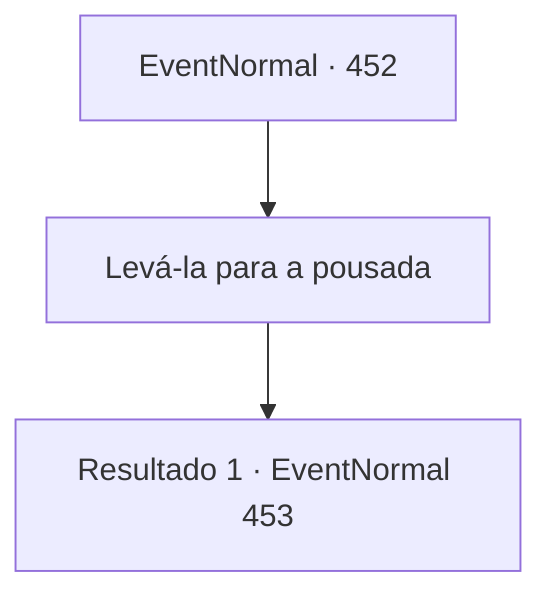

# Eventos normais · 452

[Índice da tabela](index.md) · [Índice geral](../index.md)

ID: `pt:EventNormal:452` · Fonte: `EventNormal4` · Versão: 1.2.47.

Mapeamento estático dos arquivos; a disponibilidade e a execução dependem do estado da run.

## Texto do evento

*Sem texto no arquivo.*

## Dados de entrada

```json
{
  "id": 452,
  "grade": 1,
  "place": "",
  "required": ""
}
```

## Mapa das escolhas



## Escolhas e resultados

### Escolha 1

Levá-la para a pousada

Requisitos e outros campos da escolha:

```json
{
  "required": ""
}
```

#### Resultado 1.1

Você a leva imediatamente para a pousada. O estalajadeiro se assusta ao ver Laurent assim e grita. 

 "Meu Deus...!! Rápido, aqui!"

 Você coloca Laurent ao lado de uma lareira, e o estalajadeiro a cobre com um tapete de sasquatch. 

 "Por favor, precisamos de lenha...!!"

 O estalajadeiro diz. Mas quando você está prestes a descer para pegar lenha, uma mão fria o agarra. Laurent fala com uma voz cada vez menor, segurando suas mãos. 

 "Não... deixe..."


Continuação registrada: [Evento 453](0453.md) na mesma tabela.

```json
{
  "required": "",
  "chance": "1",
  "nextEvent": 453,
  "type": 2,
  "reward": ""
}
```

## Referências que chegam a este evento

- [Evento 451 · escolha 1 · resultado 1](0451.md#escolha-1)
