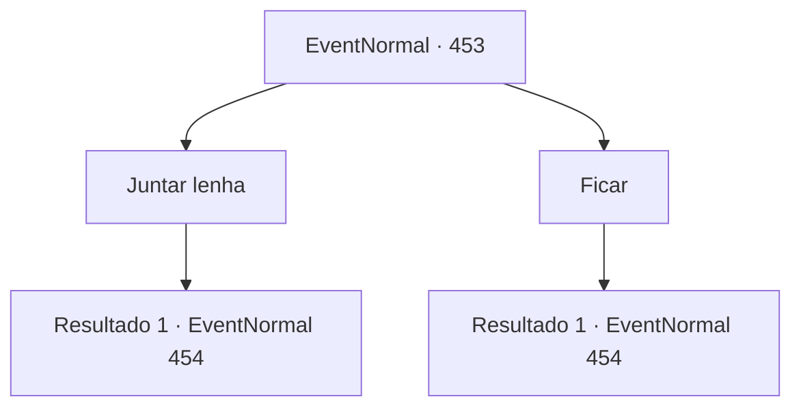

# Eventos normais · 453

[Índice da tabela](index.md) · [Índice geral](../index.md)

ID: `pt:EventNormal:453` · Fonte: `EventNormal4` · Versão: 1.2.47.

Mapeamento estático dos arquivos; a disponibilidade e a execução dependem do estado da run.

## Texto do evento

*Sem texto no arquivo.*

## Dados de entrada

```json
{
  "id": 453,
  "grade": 1,
  "place": "",
  "required": ""
}
```

## Mapa das escolhas



## Escolhas e resultados

### Escolha 1

Juntar lenha

Requisitos e outros campos da escolha:

```json
{
  "required": ""
}
```

#### Resultado 1.1

Você vai para o depósito do porão e pega um pouco de lenha. Você rapidamente volta para a lareira. Mas pelos olhares no rosto do estalajadeiro, é tarde demais. 

 "Ela era tão jovem... e... e ela foi embora assim..."

 A estalajadeira murmura para si mesma com pena. Ela então olha para você e fala. 

 "Caro ​​aventureiro. Se você não se importa... você pode me ajudar a enterrá-la, depois que a tempestade de neve terminar?"


Continuação registrada: [Evento 454](0454.md) na mesma tabela.

```json
{
  "required": "",
  "chance": "1",
  "nextEvent": 454,
  "type": 2,
  "reward": ""
}
```

### Escolha 2

Ficar

Requisitos e outros campos da escolha:

```json
{
  "required": ""
}
```

#### Resultado 2.1

Você fica ao lado de Laurent. Ela olha para você com os olhos semicerrados, antes de finalmente fechá-los. Então, suas mãos caem impotentes no chão. 

 "Ela era tão jovem... e... e ela foi embora assim..."

 A estalajadeira murmura para si mesma com pena. Ela então olha para você e fala. 

 "Caro ​​aventureiro. Se você não se importa... você pode me ajudar a enterrá-la, depois que a tempestade de neve terminar?"


Continuação registrada: [Evento 454](0454.md) na mesma tabela.

```json
{
  "required": "",
  "chance": "1",
  "nextEvent": 454,
  "type": 2,
  "reward": ""
}
```

## Referências que chegam a este evento

- [Evento 452 · escolha 1 · resultado 1](0452.md#escolha-1)
