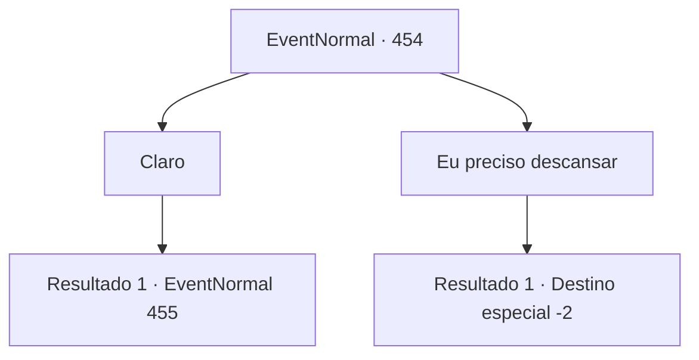

# Eventos normais · 454

[Índice da tabela](index.md) · [Índice geral](../index.md)

ID: `pt:EventNormal:454` · Fonte: `EventNormal4` · Versão: 1.2.47.

Mapeamento estático dos arquivos; a disponibilidade e a execução dependem do estado da run.

## Texto do evento

*Sem texto no arquivo.*

## Dados de entrada

```json
{
  "id": 454,
  "grade": 1,
  "place": "",
  "required": ""
}
```

## Mapa das escolhas



## Escolhas e resultados

### Escolha 1

Claro

Requisitos e outros campos da escolha:

```json
{
  "required": ""
}
```

#### Resultado 1.1

Você de bom grado decide aceitar o pedido dela. O estalajadeiro prepara uma xícara de chá quente para você e sai. Apenas os sons da tempestade de neve batendo nas janelas podem ser ouvidos. 

 A tempestade de neve começa a se acalmar após o anoitecer. O estalajadeiro volta para você, lhe entrega uma pá e fala. 

 "Bem, agora, parece que as tempestades de neve acabaram. Vamos, vamos?"


Continuação registrada: [Evento 455](0455.md) na mesma tabela.

```json
{
  "required": "",
  "chance": "1",
  "nextEvent": 455,
  "type": 2,
  "reward": "3_38_1"
}
```

### Escolha 2

Eu preciso descansar

Requisitos e outros campos da escolha:

```json
{
  "required": ""
}
```

#### Resultado 2.1

Você diz a ela que precisa descansar. O estalajadeiro responde com decepção e vai para fora. Você sai do quarto, deixando para trás o corpo sem vida de Laurent, e vai dormir em um quarto vazio. 

 No dia seguinte, você abre a porta e sai do seu quarto. Parece que o cadáver de Laurent foi cuidado. O estalajadeiro olha para você e se despede sem emoção. Você faz o mesmo e sai da pousada.

Continuação registrada: [Destino especial `-2`](../destinos-especiais.md).

```json
{
  "required": "",
  "chance": "1",
  "nextEvent": -2,
  "type": 2,
  "reward": "5_296_9|0_0_1|0_1_1"
}
```

## Referências que chegam a este evento

- [Evento 453 · escolha 1 · resultado 1](0453.md#escolha-1)
- [Evento 453 · escolha 2 · resultado 1](0453.md#escolha-2)
