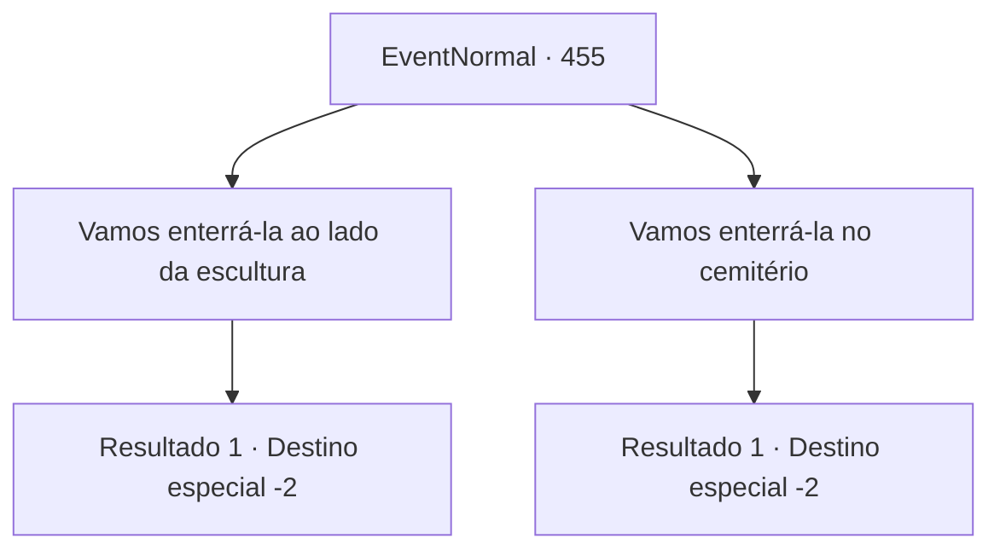

# Eventos normais · 455

[Índice da tabela](index.md) · [Índice geral](../index.md)

ID: `pt:EventNormal:455` · Fonte: `EventNormal4` · Versão: 1.2.47.

Mapeamento estático dos arquivos; a disponibilidade e a execução dependem do estado da run.

## Texto do evento

*Sem texto no arquivo.*

## Dados de entrada

```json
{
  "id": 455,
  "grade": 1,
  "place": "",
  "required": ""
}
```

## Mapa das escolhas



## Escolhas e resultados

### Escolha 1

Vamos enterrá-la ao lado da escultura

Requisitos e outros campos da escolha:

```json
{
  "required": ""
}
```

#### Resultado 1.1

Você carrega o corpo de Laurent e vai para o lugar onde a escultura dela está. A escultura de gelo permanece firme, não afetada pela tempestade de neve nem um pouco. Você coloca Laurent no chão e começa a cavar. Alguns dos moradores da cidade veem o que aconteceu e se aproximam de você e do estalajadeiro para condolências. Eles vão embora quando a sepultura estiver completa. Você e o estalajadeiro terminam os preparativos, limpando a área ao redor. Então, uma gota de água atinge nosso rosto. Quando você olha para cima, você vê a escultura derretendo. É como se a escultura estivesse chorando. A escultura derretida logo desmorona na sepultura. |drawing_fallicemasterpiece| A escultura se despedaça com um baque alto. A cena só pode ser descrita como a escultura abraçando o túmulo com força. A estalajadeira abre a boca depois de ver isso. 

 "...É como... a escultura está abraçando sua irmã. ... Obrigado por ajudar. Isso não é muito, mas por favor, pegue."

 O estalajadeiro lhe entrega um pouco de seu pão. Você os coloca na mochila. Você deixa para trás a escultura quebrada e se afasta da cidade.

Continuação registrada: [Destino especial `-2`](../destinos-especiais.md).

```json
{
  "required": "",
  "chance": "1",
  "nextEvent": -2,
  "type": 2,
  "reward": "3_224_1|5_296_9"
}
```

### Escolha 2

Vamos enterrá-la no cemitério

Requisitos e outros campos da escolha:

```json
{
  "required": ""
}
```

#### Resultado 2.1

Você carrega o corpo de Laurent e vai para o cemitério comunitário. Alguns moradores da cidade veem o que está acontecendo e se aproximam para pedir condolências. Quando o sol está prestes a se pôr, a sepultura está concluída. As pessoas da cidade começam a voltar para suas casas, mas você e o estalajadeiro permanecem e limpam a área ao redor. Então, um velho guardião do cemitério se aproxima. Ele coloca a lanterna no chão e tira uma flor vermelha. As pétalas da flor brilham fortemente mesmo no escuro. 

 "É uma camélia. Eles florescem nas condições mais adversas. Seu cheiro e cor não desaparecem, mesmo depois de serem cortados várias vezes. O frio que toma os vivos... torna-se um consolo para os mortos."

 O velho deposita a camélia no túmulo de Laurent e o respeita em silêncio. Ele então se afasta. O estalajadeiro fala. 

 "...Ela adorava flores. Espero que ela esteja feliz lá embaixo... Obrigado por ajudar. Isso não é muito, mas por favor, pegue."

 O estalajadeiro lhe entrega um pouco de seu pão. Você os coloca na mochila. Você se afasta do cemitério, deixando a cidade.

Continuação registrada: [Destino especial `-2`](../destinos-especiais.md).

```json
{
  "required": "",
  "chance": "1",
  "nextEvent": -2,
  "type": 2,
  "reward": "3_224_1|5_296_9"
}
```

## Referências que chegam a este evento

- [Evento 454 · escolha 1 · resultado 1](0454.md#escolha-1)
