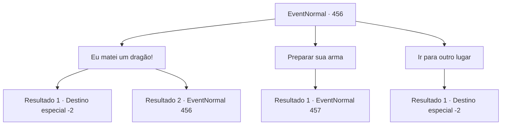

# Eventos normais · 456

[Índice da tabela](index.md) · [Índice geral](../index.md)

ID: `pt:EventNormal:456` · Fonte: `EventNormal4` · Versão: 1.2.47.

Mapeamento estático dos arquivos; a disponibilidade e a execução dependem do estado da run.

## Texto do evento

|drawing_hillGiant| Você encontra um gigante da colina, bloqueando o caminho da montanha. Ele grita que só abrirá caminho para aqueles que são maiores do que ele.

## Dados de entrada

```json
{
  "id": 456,
  "grade": 1,
  "place": "",
  "required": "5_302_0|1_2_50"
}
```

## Mapa das escolhas



## Escolhas e resultados

### Escolha 1

Eu matei um dragão!

Requisitos e outros campos da escolha:

```json
{
  "required": "5_303_0"
}
```

#### Resultado 1.1

Você grita que já matou um dragão antes. O gigante da colina fica assustado, olha para você brevemente antes de recuar. Seus olhos se arregalam de surpresa. Definitivamente caiu nas suas mentiras. 

 "E-eu vejo. Você é um ser maior do que eu. Você pode passar."

 Você passa pelo gigante da colina, passando apressado por ele.  

Continuação registrada: [Destino especial `-2`](../destinos-especiais.md).

```json
{
  "required": "",
  "chance": "1|0_12_1",
  "nextEvent": -2,
  "type": 0,
  "reward": "0_2_1|5_302_10"
}
```

#### Resultado 1.2

Você grita que já matou um dragão antes. Mas o gigante da colina balança a cabeça e responde. 

 "Hmph. Você está mentindo. Você sabe o que eu fiz? Eu realmente engoli um país inteiro de anões! Eu sou muito maior, não sou?!"

 O gigante da colina lhe diz que, como você não é maior do que ele, ele não pode deixar você passar.

Continuação registrada: [Evento 456](0456.md) na mesma tabela.

```json
{
  "required": "",
  "chance": "6",
  "nextEvent": 456,
  "type": 1,
  "reward": " 5_303_1"
}
```

### Escolha 2

Preparar sua arma

Requisitos e outros campos da escolha:

```json
{
  "required": ""
}
```

#### Resultado 2.1

Em vez de tentar inventar algo, você pega suas armas. O rosto do gigante da colina fica vermelho de raiva, enquanto ele bate no chão com seus punhos gigantes.

Continuação registrada: [Evento 457](0457.md) na mesma tabela.

```json
{
  "required": "",
  "chance": "1",
  "nextEvent": 457,
  "type": 2,
  "reward": "6_0_132",
  "place": 0
}
```

### Escolha 3

Ir para outro lugar

Requisitos e outros campos da escolha:

```json
{
  "required": ""
}
```

#### Resultado 3.1

Você deixa o gigante da colina, dá meia-volta e se afasta dele. Você ouve a risada zombeteira do gigante da colina atrás de suas costas.

Continuação registrada: [Destino especial `-2`](../destinos-especiais.md).

```json
{
  "required": "",
  "chance": "1",
  "nextEvent": -2,
  "type": 2,
  "reward": "5_302_10"
}
```

## Referências que chegam a este evento

- [Evento 456 · escolha 1 · resultado 2](0456.md#escolha-1)
