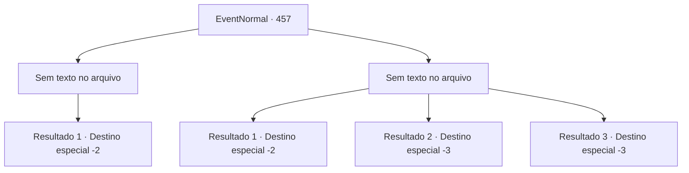

# Eventos normais · 457

[Índice da tabela](index.md) · [Índice geral](../index.md)

ID: `pt:EventNormal:457` · Fonte: `EventNormal4` · Versão: 1.2.47.

Mapeamento estático dos arquivos; a disponibilidade e a execução dependem do estado da run.

## Texto do evento

*Sem texto no arquivo.*

## Dados de entrada

```json
{
  "id": 457,
  "grade": 1,
  "place": "",
  "required": ""
}
```

## Mapa das escolhas



## Escolhas e resultados

### Escolha 1

*Sem texto no arquivo; o papel dessa opção depende da interface do jogo.*

Requisitos e outros campos da escolha:

```json
{
  "required": ""
}
```

#### Resultado 1.1

Depois que o corpo do gigante da colina cai no chão, você fica em cima de sua cabeça e observa à frente. A altura dá-lhe vantagem na visão, ajudando-o a escolher para onde ir a seguir. Você desce de sua cabeça e continua sua aventura. 

Continuação registrada: [Destino especial `-2`](../destinos-especiais.md).

```json
{
  "required": "",
  "chance": "1",
  "nextEvent": -2,
  "type": 2,
  "reward": "5_302_10"
}
```

### Escolha 2

*Sem texto no arquivo; o papel dessa opção depende da interface do jogo.*

Requisitos e outros campos da escolha:

```json
{
  "required": ""
}
```

#### Resultado 2.1

O golpe do gigante da colina faz você voar para algum lugar enquanto sua consciência desaparece.

 Depois de muito tempo, você acorda com uma forte dor de cabeça. Felizmente o gigante da colina não te perseguiu mais. Agradecendo aos deuses, você vai para outro lugar.

Continuação registrada: [Destino especial `-2`](../destinos-especiais.md).

```json
{
  "required": "1_0_2|1_1_2",
  "chance": "1",
  "nextEvent": -2,
  "type": 2,
  "reward": "0_0_-1|0_1_-1|5_302_10"
}
```

#### Resultado 2.2

O braço do gigante da colina atinge você diretamente. O forte dano leva você direto para a sua morte.

Continuação registrada: [Destino especial `-3`](../destinos-especiais.md).

```json
{
  "required": "2_0_2",
  "chance": "1",
  "nextEvent": -3,
  "type": 2,
  "reward": "0_0_-1|0_1_-1"
}
```

#### Resultado 2.3

O braço do gigante da colina atinge você diretamente. O forte dano leva você direto para a sua morte.

Continuação registrada: [Destino especial `-3`](../destinos-especiais.md).

```json
{
  "required": "2_1_2",
  "chance": "1",
  "nextEvent": -3,
  "type": 2,
  "reward": "0_0_-1|0_1_-1"
}
```

## Referências que chegam a este evento

- [Evento 456 · escolha 2 · resultado 1](0456.md#escolha-2)
