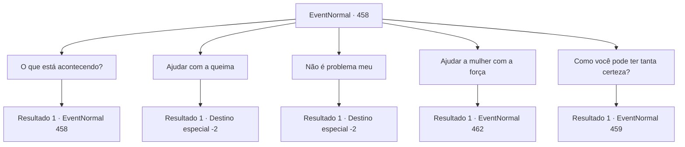

# Eventos normais · 458

[Índice da tabela](index.md) · [Índice geral](../index.md)

ID: `pt:EventNormal:458` · Fonte: `EventNormal4` · Versão: 1.2.47.

Mapeamento estático dos arquivos; a disponibilidade e a execução dependem do estado da run.

## Texto do evento

Você chega a uma cidade do interior. Ao olhar para a praça da cidade, você vê uma mulher em cordas, amarrada em cima de uma pilha de lenha. As pessoas da cidade nem percebem sua presença, murmurando com a visão. Quando um homem vestindo um manto de padre vem acender a fogueira, a mulher grita. 

 "SOCORRO! POR FAVOR, ALGUÉM ME AJUDA!"

 O manto do padre grita com ela em resposta. 

 "SILÊNCIO, DEMÔNIO! Você deveria estar HONRADA por receber a punição divina do Inquisidor 'Malak'...!"


## Dados de entrada

```json
{
  "id": 458,
  "grade": 1,
  "place": "",
  "required": "5_304_0"
}
```

## Mapa das escolhas



## Escolhas e resultados

### Escolha 1

O que está acontecendo?

Requisitos e outros campos da escolha:

```json
{
  "required": "5_305_0"
}
```

#### Resultado 1.1

Você abre caminho pela multidão e pergunta o que está acontecendo. O homem com o manto de padre avisa. 

 "Fique longe dela! Aquela mulher, 'Ketra', foi enfeitiçada por espíritos malignos e usou magia negra!"

 A chamada mulher enfeitiçada retruca. 

 "Eu NÃO estou enfeitiçada, aventureiro! Por favor, sou apenas uma viúva! ME AJUDE!"

 A cidade do interior é jogada no caos quando Ketra, Malak e as pessoas da cidade começam a gritar e murmurar. Malak sugere que a multidão se acalme e prossiga com a queima, enquanto Ketra olha para você desesperadamente.

Continuação registrada: [Evento 458](0458.md) na mesma tabela.

```json
{
  "required": "",
  "chance": "1",
  "nextEvent": 458,
  "type": 2,
  "reward": "5_305_1"
}
```

### Escolha 2

Ajudar com a queima

Requisitos e outros campos da escolha:

```json
{
  "required": "23_3_1|2_3_0"
}
```

#### Resultado 2.1

Você ajuda Malak com a queima. A pilha de galhos secos é acendida e um grande incêndio é criado. <color=red>

 "AAARRGGHHHHHH!"

</color> A mulher grita de dor enquanto é queimada até a morte, engolida pelas chamas. Os habitantes da cidade agradecem a ajuda e desejam sorte em suas aventuras. Você retorna à sua aventura com um leve cheiro de cinzas no ar.

Continuação registrada: [Destino especial `-2`](../destinos-especiais.md).

```json
{
  "required": "",
  "chance": "1",
  "nextEvent": -2,
  "type": 2,
  "reward": "0_2_1|5_304_10"
}
```

### Escolha 3

Não é problema meu

Requisitos e outros campos da escolha:

```json
{
  "required": ""
}
```

#### Resultado 3.1

Você ignora o apelo da mulher e passa. Logo, fumaça preta enche o céu. Ela provavelmente está morta. Você se apresse para fora da cidade.

Continuação registrada: [Destino especial `-2`](../destinos-especiais.md).

```json
{
  "required": "",
  "chance": "1",
  "nextEvent": -2,
  "type": 2,
  "reward": "5_304_10"
}
```

### Escolha 4

Ajudar a mulher com a força

Requisitos e outros campos da escolha:

```json
{
  "required": "5_305_1"
}
```

#### Resultado 4.1

Você rapidamente saca sua arma e desamarra a mulher das cordas. Assim que você faz isso, a voz furiosa de Malak chama sua atenção. 

 "Parece que o aventureiro também é assombrado por espíritos malignos! Junte-se a mim, pessoas! Vamos expulsar essas malditas criaturas desta cidade!"

 Então, Malak e as pessoas da cidade começam a atacar você.

Continuação registrada: [Evento 462](0462.md) na mesma tabela.

```json
{
  "required": "",
  "chance": "1",
  "nextEvent": 462,
  "type": 2,
  "reward": "6_3_49",
  "place": 4
}
```

### Escolha 5

Como você pode ter tanta certeza?

Requisitos e outros campos da escolha:

```json
{
  "required": "5_305_1|18_306_1|18_306_2"
}
```

#### Resultado 5.1

Você pergunta como ele tem tanta certeza de que a mulher está enfeitiçada. Malak responde com um olhar confuso no rosto. 

 "Por que eu deveria? Quando o inquisidor diz, tudo o que você precisa fazer é acenar com a cabeça!"


Continuação registrada: [Evento 459](0459.md) na mesma tabela.

```json
{
  "required": "",
  "chance": "1",
  "nextEvent": 459,
  "type": 2,
  "reward": "5_306_1"
}
```

## Referências que chegam a este evento

- [Evento 458 · escolha 1 · resultado 1](0458.md#escolha-1)
- [Evento 459 · escolha 1 · resultado 2](0459.md#escolha-1)
- [Evento 459 · escolha 3 · resultado 1](0459.md#escolha-3)
