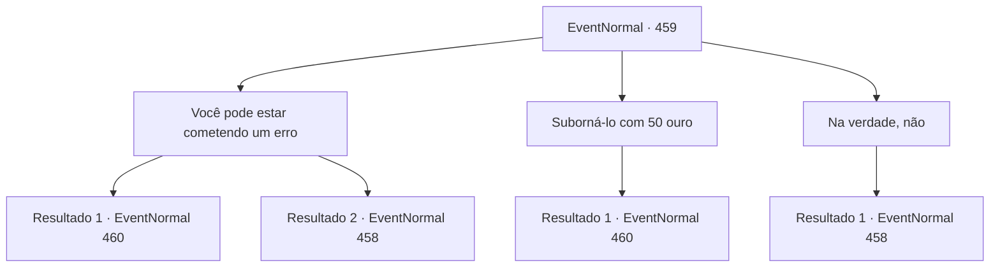

# Eventos normais · 459

[Índice da tabela](index.md) · [Índice geral](../index.md)

ID: `pt:EventNormal:459` · Fonte: `EventNormal4` · Versão: 1.2.47.

Mapeamento estático dos arquivos; a disponibilidade e a execução dependem do estado da run.

## Texto do evento

*Sem texto no arquivo.*

## Dados de entrada

```json
{
  "id": 459,
  "grade": 1,
  "place": "",
  "required": ""
}
```

## Mapa das escolhas



## Escolhas e resultados

### Escolha 1

Você pode estar cometendo um erro

Requisitos e outros campos da escolha:

```json
{
  "required": "18_306_2"
}
```

#### Resultado 1.1


 "Hã! Erro?! Eu?! Então tente falar com as pessoas da cidade. Você saberá que não estou falando nada além da verdade."

 Malak franze a testa em resposta e sai. Você sente as pessoas da cidade olhando para você com desconfiança.

Continuação registrada: [Evento 460](0460.md) na mesma tabela.

```json
{
  "required": "",
  "chance": "1|0_12_1",
  "nextEvent": 460,
  "type": 0,
  "reward": "5_306_1"
}
```

#### Resultado 1.2


 "Bobagem! Eu não estou enganado. A menos que você queira confessar que você também está enfeitiçado, você saberia o que fazer!"

 Malak franze a testa em resposta e sai. Você sente as pessoas da cidade olhando para você com desconfiança.

Continuação registrada: [Evento 458](0458.md) na mesma tabela.

```json
{
  "required": "",
  "chance": "11",
  "nextEvent": 458,
  "type": 1,
  "reward": "5_306_2"
}
```

### Escolha 2

Suborná-lo com 50 ouro

Requisitos e outros campos da escolha:

```json
{
  "required": "1_4_50"
}
```

#### Resultado 2.1

Enquanto você secretamente lhe entrega 50 ouros de seus bolsos, Malak faz o possível para esconder seu sorriso e respostas. 

 "Hmph! Você é mesmo um intrometido, não é? Certo. Você pode falar com as pessoas da cidade. Você saberá que não estou falando nada além da verdade."

 Malak pega o ouro e sai. Você sente as pessoas da cidade olhando para você com desconfiança.

Continuação registrada: [Evento 460](0460.md) na mesma tabela.

```json
{
  "required": "",
  "chance": "1",
  "nextEvent": 460,
  "type": 2,
  "reward": "0_4_-50"
}
```

### Escolha 3

Na verdade, não

Requisitos e outros campos da escolha:

```json
{
  "required": ""
}
```

#### Resultado 3.1


 "Então vá! A menos que... você queira confessar que também está enfeitiçado."

 Malak grita com você e olha para você desconfortavelmente. A multidão faz o mesmo, murmurando.

Continuação registrada: [Evento 458](0458.md) na mesma tabela.

```json
{
  "required": "",
  "chance": "1",
  "nextEvent": 458,
  "type": 2,
  "reward": "5_306_2"
}
```

## Referências que chegam a este evento

- [Evento 458 · escolha 5 · resultado 1](0458.md#escolha-5)
