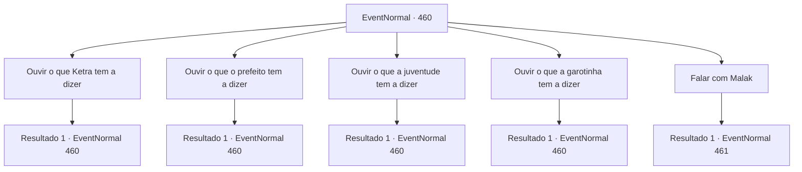

# Eventos normais · 460

[Índice da tabela](index.md) · [Índice geral](../index.md)

ID: `pt:EventNormal:460` · Fonte: `EventNormal4` · Versão: 1.2.47.

Mapeamento estático dos arquivos; a disponibilidade e a execução dependem do estado da run.

## Texto do evento

*Sem texto no arquivo.*

## Dados de entrada

```json
{
  "id": 460,
  "grade": 1,
  "place": "",
  "required": ""
}
```

## Mapa das escolhas



## Escolhas e resultados

### Escolha 1

Ouvir o que Ketra tem a dizer

Requisitos e outros campos da escolha:

```json
{
  "required": "5_307_0"
}
```

#### Resultado 1.1

Você se aproxima de Ketra e pergunta o que aconteceu. Ela começa a soluçar e explica tudo. 

 "Isso é absurdo! Eu não sei nada sobre esses... espíritos malignos!"

 Segundo Ketra, ela se estabeleceu nesta cidade seguindo o marido, que costumava ser comerciante. Depois que ele faleceu, ela mal consegue se alimentar cultivando ervas e vendendo-as no mercado. Aparentemente houve uma briga entre ela e o prefeito da cidade, sobre o que fazer com a herança do marido. Ela acha que provavelmente tem algo a ver com o que está acontecendo agora. 

 "O prefeito vinha até mim todos os dias, exigindo que eu 'doasse' o que meu marido me deixou para a cidade. Só que eu não tinha nada para herdar, porque ele usou cada moeda de ouro que tinha para investir em um novo projeto."

 Ketra implora que você coloque algum juízo sobre essas pessoas, dizendo que o prefeito provavelmente deu um falso testemunho a Malak. Você faz o possível para acalmá-la e se afasta para conversar com outras pessoas. 

Continuação registrada: [Evento 460](0460.md) na mesma tabela.

```json
{
  "required": "",
  "chance": "1",
  "nextEvent": 460,
  "type": 2,
  "reward": "5_307_1"
}
```

### Escolha 2

Ouvir o que o prefeito tem a dizer

Requisitos e outros campos da escolha:

```json
{
  "required": "5_308_0"
}
```

#### Resultado 2.1

Você procura o prefeito desta cidade. Quando você pergunta o que está acontecendo, ele fica todo bravo e começa a falar. 

 "Essa mulher certamente está enfeitiçada! A morte de seu marido foi, sem dúvida, um ritual maligno para agradar os demônios!"

 Ele se gaba de que esta cidade é segura apenas porque ele a acusou de bruxaria para Malak. 

 "Evidência?! Vá falar com o garoto 'Hannah'! Ela viu ela mesma preparando o ritual!"

 Você faz o possível para acalmar o prefeito e se afasta para conversar com outras pessoas.

Continuação registrada: [Evento 460](0460.md) na mesma tabela.

```json
{
  "required": "",
  "chance": "1",
  "nextEvent": 460,
  "type": 2,
  "reward": "5_308_1"
}
```

### Escolha 3

Ouvir o que a juventude tem a dizer

Requisitos e outros campos da escolha:

```json
{
  "required": "5_309_0"
}
```

#### Resultado 3.1

Você se aproxima de um jovem que está de olho na chamada mulher enfeitiçada e pergunta o que ele pensa sobre essa situação. Ele responde hesitante. 

 "Para ser honesto... estamos tão confusos quanto. Ketra? Enfeitiçado? Inimaginável... Mas já que o prefeito e o inquisidor dizem isso, não temos escolha a não ser acreditar neles."

 Ele faz uma expressão amarga e suspira. 

 "Há algo estranho. Nossa cidade já sofreu uma praga mortal. Ketra pegou também. Mas ela foi a única que foi completamente curada."

 O jovem diz cuidadosamente que isso pode ser uma evidência de que Ketra está enfeitiçada. Você acena com a cabeça e depois se afasta para conversar com outras pessoas.

Continuação registrada: [Evento 460](0460.md) na mesma tabela.

```json
{
  "required": "",
  "chance": "1",
  "nextEvent": 460,
  "type": 2,
  "reward": "5_309_1"
}
```

### Escolha 4

Ouvir o que a garotinha tem a dizer

Requisitos e outros campos da escolha:

```json
{
  "required": "5_310_0"
}
```

#### Resultado 4.1

Você se aproxima de uma garota, observando a multidão de longe. Você pergunta a ela qual é o nome dela. 

 "Eu me chamo Hannah. Ei, aventureiro! Estou entediado, quer conversar?"

 Hannah é uma garotinha. Você estima que ela tenha cerca de seis anos. Você acena com a cabeça, e Hannah começa a falar sobre o que viu antes. Uma dessas histórias era que Ketra estava fazendo algum tipo de sopa em uma panela que cheirava estranhamente, enquanto cantava algum tipo de cântico em uma língua misteriosa. 

 "Sério, eu não tinha ideia do que ela estava dizendo! Ah, e também vi o prefeito e o inquisidor trocando algo realmente brilhante também!"

 A história de Hannah continuou por um tempo. Você dá um tapinha na cabeça de Hannah e se afasta rapidamente.

Continuação registrada: [Evento 460](0460.md) na mesma tabela.

```json
{
  "required": "",
  "chance": "1",
  "nextEvent": 460,
  "type": 2,
  "reward": "5_310_1"
}
```

### Escolha 5

Falar com Malak

Requisitos e outros campos da escolha:

```json
{
  "required": "5_307_1|5_308_1|5_309_1|5_310_1"
}
```

#### Resultado 5.1

No momento em que você conversou com as pessoas da cidade, o sol já havia se posto. Malak volta à praça com uma tocha nas mãos. 

 "Satisfeito? Suas perguntas foram respondidas? Agora, então. Pare de interferir nos meus negócios e siga em frente."


Continuação registrada: [Evento 461](0461.md) na mesma tabela.

```json
{
  "required": "",
  "chance": "1",
  "nextEvent": 461,
  "type": 2,
  "reward": ""
}
```

## Referências que chegam a este evento

- [Evento 459 · escolha 1 · resultado 1](0459.md#escolha-1)
- [Evento 459 · escolha 2 · resultado 1](0459.md#escolha-2)
- [Evento 460 · escolha 1 · resultado 1](0460.md#escolha-1)
- [Evento 460 · escolha 2 · resultado 1](0460.md#escolha-2)
- [Evento 460 · escolha 3 · resultado 1](0460.md#escolha-3)
- [Evento 460 · escolha 4 · resultado 1](0460.md#escolha-4)
