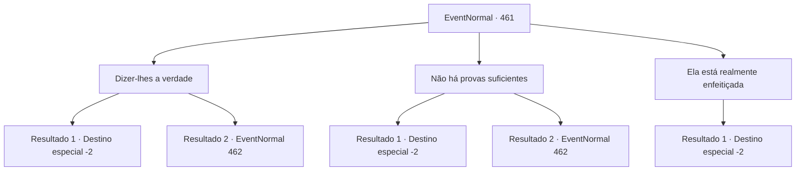

# Eventos normais · 461

[Índice da tabela](index.md) · [Índice geral](../index.md)

ID: `pt:EventNormal:461` · Fonte: `EventNormal4` · Versão: 1.2.47.

Mapeamento estático dos arquivos; a disponibilidade e a execução dependem do estado da run.

## Texto do evento

*Sem texto no arquivo.*

## Dados de entrada

```json
{
  "id": 461,
  "grade": 1,
  "place": "",
  "required": ""
}
```

## Mapa das escolhas



## Escolhas e resultados

### Escolha 1

Dizer-lhes a verdade

Requisitos e outros campos da escolha:

```json
{
  "required": ""
}
```

#### Resultado 1.1

Você acusa o prefeito de subornar o inquisidor. Você confiantemente usa o testemunho de Hannah como prova, e ela concorda com a cabeça também. 

 "N-não! Isso... isso é..."

 Malak aperta suas mãos em negação, mas não consegue acalmar as pessoas da cidade. Infelizmente, ele foge às pressas da cidade. O prefeito faz o mesmo. Com o caso resolvido, os moradores da cidade pedem desculpas a Ketra e a desamarram. 

 "Ah... obrigado, obrigado, aventureiro!"

 Ketra mostra sua gratidão e lhe dá algumas das ervas medicinais que ela colheu nas montanhas. Você pega os que precisa e volta para suas aventuras.

Continuação registrada: [Destino especial `-2`](../destinos-especiais.md).

```json
{
  "required": "",
  "chance": "1|0_12_1",
  "nextEvent": -2,
  "type": 0,
  "reward": "0_2_1|3_134_1|5_304_10"
}
```

#### Resultado 1.2

Você acusa o prefeito de subornar o inquisidor. Você usa cuidadosamente o testemunho de Hannah como prova, e ela concorda com a cabeça também. 

 "T-isso é tudo um mal-entendido! Parece que o aventureiro também está enfeitiçado! Como ele ousa me acusar de um comportamento tão sujo!"

 Malak nega sua acusação e incita as pessoas a atacá-lo. As pessoas da cidade ainda não parecem totalmente convencidas, mas a contínua reunião de Malak faz com que eles avancem até você com ferramentas agrícolas como armas.

Continuação registrada: [Evento 462](0462.md) na mesma tabela.

```json
{
  "required": "",
  "chance": "13",
  "nextEvent": 462,
  "type": 1,
  "reward": "6_3_49",
  "place": 4
}
```

### Escolha 2

Não há provas suficientes

Requisitos e outros campos da escolha:

```json
{
  "required": ""
}
```

#### Resultado 2.1

Você aponta que não há provas suficientes que apoiem a culpa dela. A única evidência que existe são os testemunhos dos habitantes da cidade. Você exige que eles apresentem uma evidência material sólida. Malak balança a cabeça com firmeza e grita. 

 "É isso que eu ouço? Você não pode confiar em um inquisidor, hein?! Parece que o aventureiro também está enfeitiçado! Junte-se a mim, pessoal! Vamos expulsar essas malditas criaturas desta cidade!"

 Mas as pessoas da cidade não se movem um centímetro. Em vez disso, eles ficam do seu lado, apoiando o seu lado do argumento. Eles exigem que Malak se explique. Malak cora de raiva e grita. 

 "D-droga! Tá bom! Faça como todos desejam! E você... Vou ficar de olho em você. Então é melhor você ter cuidado!"

 Malak deixa a cidade com raiva, e os moradores começam a discutir. Não há lugar para você nessa discussão, então você sai silenciosamente da cidade.

Continuação registrada: [Destino especial `-2`](../destinos-especiais.md).

```json
{
  "required": "",
  "chance": "1|0_7_1",
  "nextEvent": -2,
  "type": 0,
  "reward": "0_2_1|0_3_1|5_304_10"
}
```

#### Resultado 2.2

Você aponta que não há provas suficientes que apoiem a culpa dela. A única evidência que existe são os testemunhos dos habitantes da cidade. Você exige que eles apresentem uma evidência material sólida. Malak balança a cabeça com firmeza e grita. 

 "É isso que eu ouço? Você não pode confiar em um inquisidor, hein?! Parece que o aventureiro também está enfeitiçado! Junte-se a mim, pessoal! Vamos expulsar essas malditas criaturas desta cidade!"

 Assim que ele grita, as pessoas da cidade se reúnem e começam a atacar você. Infelizmente, você saca sua arma e se prepara para combatê-los.

Continuação registrada: [Evento 462](0462.md) na mesma tabela.

```json
{
  "required": "",
  "chance": "13",
  "nextEvent": 462,
  "type": 1,
  "reward": "6_3_49",
  "place": 4
}
```

### Escolha 3

Ela está realmente enfeitiçada

Requisitos e outros campos da escolha:

```json
{
  "required": ""
}
```

#### Resultado 3.1

Baseando seu argumento no que ouviu das pessoas da cidade, você diz que Ketra está realmente enfeitiçada. Malak resmunga, que foi tudo uma perda de tempo, dando a você a oportunidade em primeiro lugar. Ele então acende a pilha de galhos em chamas. A pilha de galhos secos é acendida e um grande incêndio é criado. <color=red>

 "AAARRGGHHHHHH!"

</color> A mulher grita de dor enquanto é queimada até a morte, engolida pelas chamas. Você sai da cidade, se afastando da fumaça preta.

Continuação registrada: [Destino especial `-2`](../destinos-especiais.md).

```json
{
  "required": "",
  "chance": "1",
  "nextEvent": -2,
  "type": 2,
  "reward": "0_2_1|0_3_-1|5_304_10"
}
```

## Referências que chegam a este evento

- [Evento 460 · escolha 5 · resultado 1](0460.md#escolha-5)
