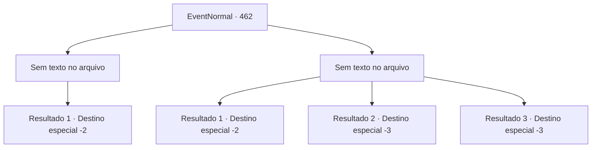

# Eventos normais · 462

[Índice da tabela](index.md) · [Índice geral](../index.md)

ID: `pt:EventNormal:462` · Fonte: `EventNormal4` · Versão: 1.2.47.

Mapeamento estático dos arquivos; a disponibilidade e a execução dependem do estado da run.

## Texto do evento

*Sem texto no arquivo.*

## Dados de entrada

```json
{
  "id": 462,
  "grade": 1,
  "place": "",
  "required": ""
}
```

## Mapa das escolhas



## Escolhas e resultados

### Escolha 1

*Sem texto no arquivo; o papel dessa opção depende da interface do jogo.*

Requisitos e outros campos da escolha:

```json
{
  "required": ""
}
```

#### Resultado 1.1

Quando você derrota Malak, as pessoas da cidade fogem aterrorizadas. Depois que a praça estiver vazia, você ajuda Ketra a se levantar e sugere que ela saia da cidade. 

 "Ah... obrigado, aventureiro."

 Ketra lhe entrega uma pilha variada de ervas medicinais montanhosas, como símbolos de gratidão. Ela então sai da cidade com você e logo se separa de você também, dizendo que está planejando voltar para sua cidade natal.

Continuação registrada: [Destino especial `-2`](../destinos-especiais.md).

```json
{
  "required": "",
  "chance": "1",
  "nextEvent": -2,
  "type": 2,
  "reward": "3_134_1|5_304_10"
}
```

### Escolha 2

*Sem texto no arquivo; o papel dessa opção depende da interface do jogo.*

Requisitos e outros campos da escolha:

```json
{
  "required": ""
}
```

#### Resultado 2.1

Assim que você se vira e começa a correr, Malak tenta controlar as pessoas da cidade gritando. 

 "Não devemos ir cegamente atrás de outros demônios! Pode ser uma armadilha, então devemos lidar com isso primeiro."

 Logo, os gritos de Ketra podem ser ouvidos e a fumaça preta enche o céu. Ela provavelmente está morta. Você se apressa para longe da cidade. 

Continuação registrada: [Destino especial `-2`](../destinos-especiais.md).

```json
{
  "required": "1_0_2|1_1_2",
  "chance": "1",
  "nextEvent": -2,
  "type": 2,
  "reward": "0_0_-1|0_1_-1|5_304_10"
}
```

#### Resultado 2.2

As pessoas da cidade acusam você de estar enfeitiçado, batendo em você sem piedade. Tudo termina quando Malak atinge sua cabeça com sua maça.

Continuação registrada: [Destino especial `-3`](../destinos-especiais.md).

```json
{
  "required": "2_0_2",
  "chance": "1",
  "nextEvent": -3,
  "type": 2,
  "reward": "0_0_-1|0_1_-1"
}
```

#### Resultado 2.3

As pessoas da cidade acusam você de estar enfeitiçado, batendo em você sem piedade. Tudo termina quando Malak atinge sua cabeça com sua maça.

Continuação registrada: [Destino especial `-3`](../destinos-especiais.md).

```json
{
  "required": "2_1_2",
  "chance": "1",
  "nextEvent": -3,
  "type": 2,
  "reward": "0_0_-1|0_1_-1"
}
```

## Referências que chegam a este evento

- [Evento 458 · escolha 4 · resultado 1](0458.md#escolha-4)
- [Evento 461 · escolha 1 · resultado 2](0461.md#escolha-1)
- [Evento 461 · escolha 2 · resultado 2](0461.md#escolha-2)
