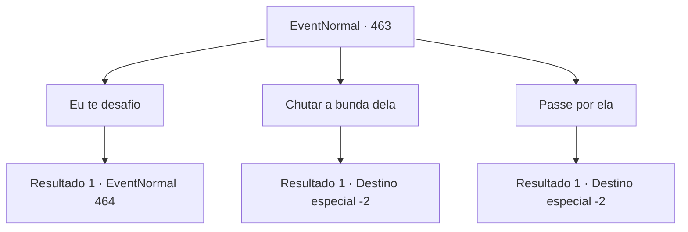

# Eventos normais · 463

[Índice da tabela](index.md) · [Índice geral](../index.md)

ID: `pt:EventNormal:463` · Fonte: `EventNormal4` · Versão: 1.2.47.

Mapeamento estático dos arquivos; a disponibilidade e a execução dependem do estado da run.

## Texto do evento

WHOOOOSH! CRACK!'

 Enquanto você está andando na floresta, você ouve algo cortando o ar. Você segue o som e chega a uma clareira, onde alguns arqueiros competem pela precisão. A maioria dos competidores são humanos, mas o vencedor é um elfo chamado 'Ninien'. Ela reorganiza o cabelo e ri dos outros arqueiros. 

 "Ha, agora eu sei. As habilidades de tiro com arco de vocês humanos são tão chatas... Vocês noobs me entediam até a morte. Existe ALGUÉM que pode atirar tão bem quanto eu?"

 Outros arqueiros humanos ficam envergonhados depois de ouvir Ninien.

## Dados de entrada

```json
{
  "id": 463,
  "grade": 1,
  "place": "",
  "required": "5_311_0"
}
```

## Mapa das escolhas



## Escolhas e resultados

### Escolha 1

Eu te desafio

Requisitos e outros campos da escolha:

```json
{
  "required": ""
}
```

#### Resultado 1.1

Você se aproxima dela e a desafia para um duelo. Ninien sorri e responde. 

 "Multar. Mas eu vou escolher como o duelo é feito. Tudo bem?"

 Ela explica o tipo de duelo que ela planejou. Ambos os competidores começarão de costas um para o outro, darão três passos em suas respectivas direções, virarão e atirarão no oponente para a vitória. 

 "Este duelo pode ser letal. Sinta-se à vontade para desistir, se estiver com medo."

 

Continuação registrada: [Evento 464](0464.md) na mesma tabela.

```json
{
  "required": "",
  "chance": "1",
  "nextEvent": 464,
  "type": 2,
  "reward": "0_2_1|5_311_9"
}
```

### Escolha 2

Chutar a bunda dela

Requisitos e outros campos da escolha:

```json
{
  "required": "2_3_0"
}
```

#### Resultado 2.1

Você se aproxima de Ninien e chuta a bunda dela. Ela grita de dor e cora, lançando um olhar malicioso para você. 

 "É assim que você reage a alguém com habilidades superiores?! Nossa - que bárbaro!"

 Ninien reclama e depois desaparece na floresta. Os arqueiros humanos dão um sinal de positivo e você sai da clareira enquanto eles torcem por você pelo que você fez.

Continuação registrada: [Destino especial `-2`](../destinos-especiais.md).

```json
{
  "required": "",
  "chance": "1",
  "nextEvent": -2,
  "type": 2,
  "reward": "0_2_1|5_311_9"
}
```

### Escolha 3

Passe por ela

Requisitos e outros campos da escolha:

```json
{
  "required": ""
}
```

#### Resultado 3.1

Você deixa o elfo arrogante para trás e vai embora.

Continuação registrada: [Destino especial `-2`](../destinos-especiais.md).

```json
{
  "required": "",
  "chance": "1",
  "nextEvent": -2,
  "type": 2,
  "reward": "5_311_9"
}
```

## Referências que chegam a este evento

Nenhum `nextEvent` positivo da mesma tabela aponta para este nó. Isso não prova que seja inacessível: sorteio e estado de história podem selecioná-lo.

