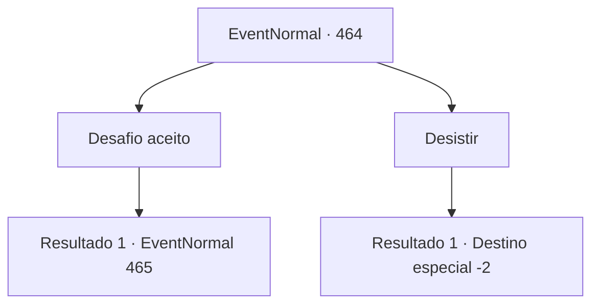

# Eventos normais · 464

[Índice da tabela](index.md) · [Índice geral](../index.md)

ID: `pt:EventNormal:464` · Fonte: `EventNormal4` · Versão: 1.2.47.

Mapeamento estático dos arquivos; a disponibilidade e a execução dependem do estado da run.

## Texto do evento

*Sem texto no arquivo.*

## Dados de entrada

```json
{
  "id": 464,
  "grade": 1,
  "place": "",
  "required": ""
}
```

## Mapa das escolhas



## Escolhas e resultados

### Escolha 1

Desafio aceito

Requisitos e outros campos da escolha:

```json
{
  "required": ""
}
```

#### Resultado 1.1

Você aceita o desafio dela. Você recebe uma reverência de prática e fica ao lado de Ninien, as costas se tocando. Assim que ela dá um passo, você faz o mesmo.

Continuação registrada: [Evento 465](0465.md) na mesma tabela.

```json
{
  "required": "",
  "chance": "1",
  "nextEvent": 465,
  "type": 2,
  "reward": "3_21_1"
}
```

### Escolha 2

Desistir

Requisitos e outros campos da escolha:

```json
{
  "required": ""
}
```

#### Resultado 2.1


 "Bom. Eu não queria forçar um covarde a um duelo de qualquer maneira."

 Ninien zomba de você por desistir do duelo e desaparece na floresta. Assim que ela sai, os arqueiros humanos começam a reclamar. 

 "Pft, se você não tinha o que é preciso, talvez você não devesse tê-la desafiado em primeiro lugar."

 "Patético. Tudo o que você fez foi fazer aquele elfo se sentir ainda mais arrogante."

 Você sai apressadamente da clareira, longe de suas queixas.

Continuação registrada: [Destino especial `-2`](../destinos-especiais.md).

```json
{
  "required": "",
  "chance": "1",
  "nextEvent": -2,
  "type": 2,
  "reward": "5_311_9"
}
```

## Referências que chegam a este evento

- [Evento 463 · escolha 1 · resultado 1](0463.md#escolha-1)
