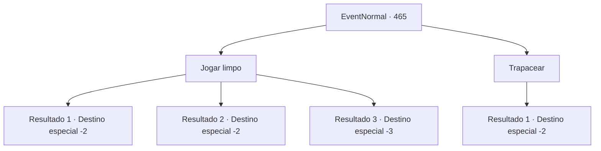

# Eventos normais · 465

[Índice da tabela](index.md) · [Índice geral](../index.md)

ID: `pt:EventNormal:465` · Fonte: `EventNormal4` · Versão: 1.2.47.

Mapeamento estático dos arquivos; a disponibilidade e a execução dependem do estado da run.

## Texto do evento

*Sem texto no arquivo.*

## Dados de entrada

```json
{
  "id": 465,
  "grade": 1,
  "place": "",
  "required": ""
}
```

## Mapa das escolhas



## Escolhas e resultados

### Escolha 1

Jogar limpo

Requisitos e outros campos da escolha:

```json
{
  "required": ""
}
```

#### Resultado 1.1

No seu terceiro passo, você rapidamente dá uma cambalhota e dispara. Graças aos seus movimentos malucos, a flecha de Ninien voa no ar, enquanto seu tiro cai perfeitamente no braço esquerdo dela. Ninien deixa cair o arco no chão e se ajoelha. 

 "U-inacreditável... eu perdi para um humano?!"

 Os outros arqueiros caíram na gargalhada depois de vê-la derrotada. 

 "Phahaha! Diga isso de novo, pequeno elfo! Você estava dizendo-?"

 "É tudo mentira! Elfos sendo melhores arqueiros que humanos."

 Incapaz de se controlar, Ninien deixa seu arco e foge para a floresta. Você pega o arco dela e volta para sua aventura.

Continuação registrada: [Destino especial `-2`](../destinos-especiais.md).

```json
{
  "required": "",
  "chance": "1|0_6_1",
  "nextEvent": -2,
  "type": 0,
  "reward": "0_2_1|3_236_1|5_311_1"
}
```

#### Resultado 1.2

No seu terceiro passo, você se vira e tenta atirar, mas Ninien é mais rápido. A flecha dela voa como, bem, uma flecha, e cai no seu braço esquerdo. Ninien empurra o cabelo sobre a cabeça e fala. 

 "Bem, você tem coragem, eu vou te dar isso. Mas você simplesmente não pode vencer um elfo. Agora, se você me der licença."

 Ninien te provoca mais antes de desaparecer na floresta. Assim que ela sai, os arqueiros humanos começam a reclamar. 

 "Pft, se você não tinha o que é preciso, talvez você não devesse tê-la desafiado em primeiro lugar."

 "Patético. Tudo o que você fez foi fazer aquele elfo se sentir ainda mais arrogante."

 Você sai apressadamente da clareira, tentando arrancar a flecha do seu braço.

Continuação registrada: [Destino especial `-2`](../destinos-especiais.md).

```json
{
  "required": "1_0_2",
  "chance": "25",
  "nextEvent": -2,
  "type": 1,
  "reward": "0_0_-1"
}
```

#### Resultado 1.3

No seu terceiro passo, você se vira e tenta atirar, mas Ninien é mais rápido. Você cospe sangue na súbita onda de dor e cai no chão.

Continuação registrada: [Destino especial `-3`](../destinos-especiais.md).

```json
{
  "required": "2_0_2",
  "chance": "25",
  "nextEvent": -3,
  "type": 1,
  "reward": "0_0_-1"
}
```

### Escolha 2

Trapacear

Requisitos e outros campos da escolha:

```json
{
  "required": "2_3_-14"
}
```

#### Resultado 2.1

No seu segundo passo, você rapidamente se vira para atirar nas costas de Ninien. Sua flecha voa no peito de Ninien assim que ela se vira. <color=red>

 "CAUCK.....!!"

</color> Ela não consegue se levantar. Mas em vez de sentir remorso, os arqueiros humanos começam a rir, dizendo que ela merecia. Você puxa o arco de seu corpo sem vida e vai embora.

Continuação registrada: [Destino especial `-2`](../destinos-especiais.md).

```json
{
  "required": "",
  "chance": "1",
  "nextEvent": -2,
  "type": 2,
  "reward": "3_236_1|0_3_-5|5_311_9"
}
```

## Referências que chegam a este evento

- [Evento 464 · escolha 1 · resultado 1](0464.md#escolha-1)
