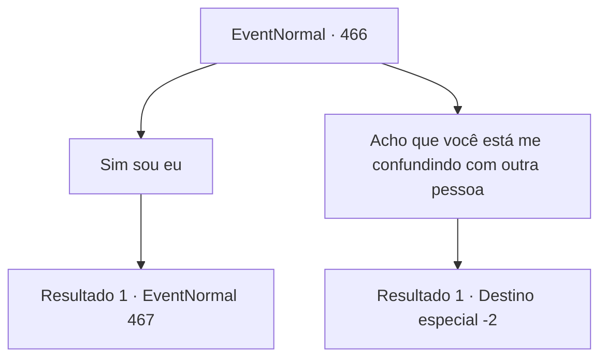

# Eventos normais · 466

[Índice da tabela](index.md) · [Índice geral](../index.md)

ID: `pt:EventNormal:466` · Fonte: `EventNormal4` · Versão: 1.2.47.

Mapeamento estático dos arquivos; a disponibilidade e a execução dependem do estado da run.

## Texto do evento

Você entra em uma loja com a placa 'Golden Skull Adventurer's Supply'. Há vários itens em exposição, mas você é o único cliente. Você examina a alça de uma mochila e verifica a etiqueta de preço. Nesse momento, você ouve uma voz abrupta chamando você por trás. 

 "Peço desculpas. Você não é {1}, por acaso?"

 Você olha para trás e vê um homem gordinho sorrindo para você.

## Dados de entrada

```json
{
  "id": 466,
  "grade": 1,
  "place": "",
  "required": "5_339_0|1_2_35"
}
```

## Mapa das escolhas



## Escolhas e resultados

### Escolha 1

Sim sou eu

Requisitos e outros campos da escolha:

```json
{
  "required": ""
}
```

#### Resultado 1.1

Assim que você responde 'sim', o homem esfrega as mãos como uma mosca, e continua. 

 "Afinal de contas, meus olhos não estão errados. Meu nome é 'Schwain'. Podemos falar por um momento?"

 Antes mesmo que você possa responder, Schwain tagarela sobre o passado dele. Ele diz que era um mercador na 'Caravana Crânio Dourado', e recentemente montou um negócio de loja de varejo para aventureiros. 

 "Mas como você pode ver, o negócio não está indo bem. Se estiver bom para você... Você se importaria em assinar um contrato comigo?"

 Schwain rapidamente pixa o contrato e te mostra. Está escrito que você recebe 80 moedas de ouro por promover a loja.

Continuação registrada: [Evento 467](0467.md) na mesma tabela.

```json
{
  "required": "",
  "chance": "1",
  "nextEvent": 467,
  "type": 2,
  "reward": ""
}
```

### Escolha 2

Acho que você está me confundindo com outra pessoa

Requisitos e outros campos da escolha:

```json
{
  "required": ""
}
```

#### Resultado 2.1

Pela sua resposta firme, Schwain parece constrangido. Você dá uma olhada nos itens exibidos e então deixa a loja.

Continuação registrada: [Destino especial `-2`](../destinos-especiais.md).

```json
{
  "required": "",
  "chance": "1",
  "nextEvent": -2,
  "type": 2,
  "reward": "5_339_9"
}
```

## Referências que chegam a este evento

Nenhum `nextEvent` positivo da mesma tabela aponta para este nó. Isso não prova que seja inacessível: sorteio e estado de história podem selecioná-lo.

