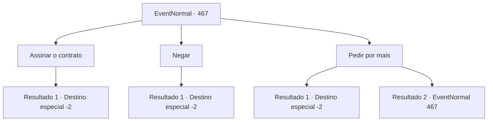

# Eventos normais · 467

[Índice da tabela](index.md) · [Índice geral](../index.md)

ID: `pt:EventNormal:467` · Fonte: `EventNormal4` · Versão: 1.2.47.

Mapeamento estático dos arquivos; a disponibilidade e a execução dependem do estado da run.

## Texto do evento

*Sem texto no arquivo.*

## Dados de entrada

```json
{
  "id": 467,
  "grade": 1,
  "place": "",
  "required": ""
}
```

## Mapa das escolhas



## Escolhas e resultados

### Escolha 1

Assinar o contrato

Requisitos e outros campos da escolha:

```json
{
  "required": ""
}
```

#### Resultado 1.1

Você aceita a oferta ao assinar o contrato. Então, com um sorriso, Schwain oferece uma capa bordada com um crânio dourado. 

 "Haha! Que cartaz maravilhoso você é. Por favor use isso a partir de agora."

 Ele amarra a capa para você e entrega uma bolsa tinindo com moedas. Você a pega e vai embora, agitando a sua capa.

Continuação registrada: [Destino especial `-2`](../destinos-especiais.md).

```json
{
  "required": "",
  "chance": "1",
  "nextEvent": -2,
  "type": 2,
  "reward": "0_4_80|5_339_1|3_243_1"
}
```

### Escolha 2

Negar

Requisitos e outros campos da escolha:

```json
{
  "required": ""
}
```

#### Resultado 2.1

Você recusa a proposta dele e deixa a loja. 

Continuação registrada: [Destino especial `-2`](../destinos-especiais.md).

```json
{
  "required": "",
  "chance": "1",
  "nextEvent": -2,
  "type": 2,
  "reward": "5_339_9"
}
```

### Escolha 3

Pedir por mais

Requisitos e outros campos da escolha:

```json
{
  "required": "1_12_11|5_340_0"
}
```

#### Resultado 3.1

Você contesta que vale muito mais que aquilo. Schwain pensa por um momento, então estica quatro dedos. 

 "Tudo bem. Eu vou te dar 40  moedas extras, o que faz 120 no total. O que acha?"

 Após barganhar, você assina o contrato e aceita a oferta dele. Então, com um sorriso, Schwain oferece uma capa bordada com um crânio dourado. 

 "Haha! Que cartaz maravilhoso você é. Por favor use isso a partir de agora."

 Ele amarra a capa para você e entrega uma bolsa tinindo com moedas. Você a pega e vai embora, agitando a sua capa.

Continuação registrada: [Destino especial `-2`](../destinos-especiais.md).

```json
{
  "required": "",
  "chance": "1|0_12_1",
  "nextEvent": -2,
  "type": 0,
  "reward": "0_4_120|5_339_1|3_243_1|5_340_1"
}
```

#### Resultado 3.2

Você contesta que vale muito mais que aquilo. No entanto, Schwain balança a cabeça firmemente e diz que 80 moedas se ouro é um preço razoável.

Continuação registrada: [Evento 467](0467.md) na mesma tabela.

```json
{
  "required": "",
  "chance": "13",
  "nextEvent": 467,
  "type": 1,
  "reward": "5_340_2"
}
```

## Referências que chegam a este evento

- [Evento 466 · escolha 1 · resultado 1](0466.md#escolha-1)
- [Evento 467 · escolha 3 · resultado 2](0467.md#escolha-3)
