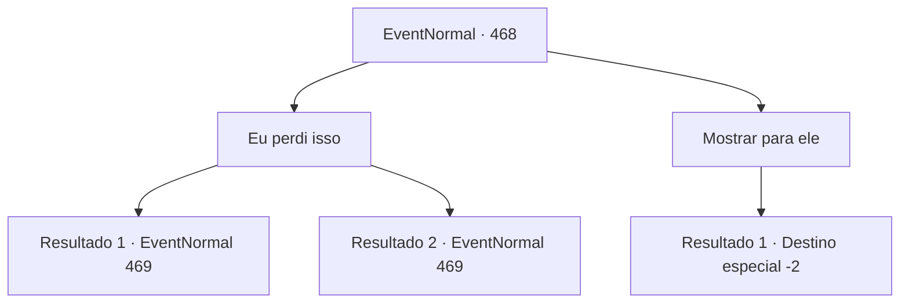

# Eventos normais · 468

[Índice da tabela](index.md) · [Índice geral](../index.md)

ID: `pt:EventNormal:468` · Fonte: `EventNormal4` · Versão: 1.2.47.

Mapeamento estático dos arquivos; a disponibilidade e a execução dependem do estado da run.

## Texto do evento

Você para de andar com o som de uma carruagem. Olhando em volta, você você enxerga uma carruagem se aproximando, com uma bandeira de caveira dourada. A carruagem para em sua frente, deixando uma nuvem de poeira. Então Schwain sai com seus guardas. 

 "Minha nossa. Não é {1}? Bem bem... Bom te ver de novo. Há quanto tempo."

 Schwain, que te pediu para promover a loja dele, oferece um aperto de mão. Você pode ver os olhos serrados dele através de você. 

 "A propósito, Eu acredito que você ainda esteja vestindo a capa?"


## Dados de entrada

```json
{
  "id": 468,
  "grade": 1,
  "place": "",
  "required": "5_339_1"
}
```

## Mapa das escolhas



## Escolhas e resultados

### Escolha 1

Eu perdi isso

Requisitos e outros campos da escolha:

```json
{
  "required": "10_243_1"
}
```

#### Resultado 1.1

Você responde que você a perdeu. Schawin cora e berra para você. 

 "ESTÁ FALANDO SÉRIO! Você está insinuando  que eu paguei você por nada?"

 Schwain levanta a voz e empurra o contrato na sua frente. Ele exige 360 moedas de ouro como compensação.

Continuação registrada: [Evento 469](0469.md) na mesma tabela.

```json
{
  "required": "5_340_1",
  "chance": "1",
  "nextEvent": 469,
  "type": 2,
  "reward": ""
}
```

#### Resultado 1.2

Você responde que a perdeu. Schwain cora e berra para você. 

 "ESTÁ FALANDO SÉRIO! Você está insistindo que eu te paguei por nada?"

 Schwain levanta a voz e empurra o contrato na sua frente. Ele exige 240 moedas de ouro como compensação.

Continuação registrada: [Evento 469](0469.md) na mesma tabela.

```json
{
  "required": "18_340_1",
  "chance": "1",
  "nextEvent": 469,
  "type": 2,
  "reward": ""
}
```

### Escolha 2

Mostrar para ele

Requisitos e outros campos da escolha:

```json
{
  "required": "8_243_1"
}
```

#### Resultado 2.1

Você o mostra a capa com o emblema da 'Caravana Crânio Dourado'. Ela ficou um pouco desbotada durante a jornada, mas ainda está bonita. Schwain fala com um sorriso. 

 "Haha. Vejo que você está cumprindo o contrato. Obrigado. Por favor continue o bom trabalho."

 Ele agradece e te entrega duas poções. Então ele sobe na carruagem e vai embora.

Continuação registrada: [Destino especial `-2`](../destinos-especiais.md).

```json
{
  "required": "",
  "chance": "1",
  "nextEvent": -2,
  "type": 2,
  "reward": "3_36_1|3_37_1|5_339_10"
}
```

## Referências que chegam a este evento

Nenhum `nextEvent` positivo da mesma tabela aponta para este nó. Isso não prova que seja inacessível: sorteio e estado de história podem selecioná-lo.

