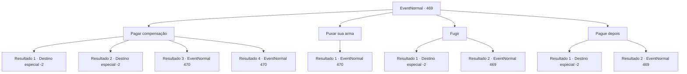

# Eventos normais · 469

[Índice da tabela](index.md) · [Índice geral](../index.md)

ID: `pt:EventNormal:469` · Fonte: `EventNormal4` · Versão: 1.2.47.

Mapeamento estático dos arquivos; a disponibilidade e a execução dependem do estado da run.

## Texto do evento

*Sem texto no arquivo.*

## Dados de entrada

```json
{
  "id": 469,
  "grade": 1,
  "place": "",
  "required": ""
}
```

## Mapa das escolhas



## Escolhas e resultados

### Escolha 1

Pagar compensação

Requisitos e outros campos da escolha:

```json
{
  "required": ""
}
```

#### Resultado 1.1

Você o entrega a compensação sem fazer alarde. Schwain recebe e volta para a carruagem. A carruagem se move devagar de novo e desaparece da sua vista.

Continuação registrada: [Destino especial `-2`](../destinos-especiais.md).

```json
{
  "required": "5_340_1|1_4_360",
  "chance": "1",
  "nextEvent": -2,
  "type": 2,
  "reward": "0_4_-360|5_339_10"
}
```

#### Resultado 1.2

Você o entrega a compensação sem fazer alarde. Schwain recebe e volta para a carruagem. A carruagem se move devagar de novo e desaparece da sua vista.

Continuação registrada: [Destino especial `-2`](../destinos-especiais.md).

```json
{
  "required": "18_340_1|1_4_240",
  "chance": "1",
  "nextEvent": -2,
  "type": 2,
  "reward": "0_4_-240|5_339_10"
}
```

#### Resultado 1.3

Você vasculha a sua bolsa para pagar a compensação. No entanto, você percebe que não tem ouro suficiente. Schwain olha para na cara e fala. 

 "Não é possível que você esteja com pouco ouro?"

 Assim que ele termina de falar, os guardas sacam suas espadas e te rodeiam.

Continuação registrada: [Evento 470](0470.md) na mesma tabela.

```json
{
  "required": "5_340_1|2_4_360",
  "chance": "1",
  "nextEvent": 470,
  "type": 2,
  "reward": "6_3_91",
  "place": 0
}
```

#### Resultado 1.4

Você vasculha a sua bolsa para pagar a compensação. No entanto, você percebe que não tem ouro suficiente. Schwain olha para na cara e fala. 

 "Não é possível que você esteja com pouco ouro?"

 Assim que ele termina de falar, os guardas sacam suas espadas e te rodeiam.

Continuação registrada: [Evento 470](0470.md) na mesma tabela.

```json
{
  "required": "18_340_1|2_4_240",
  "chance": "1",
  "nextEvent": 470,
  "type": 2,
  "reward": "6_3_91",
  "place": 0
}
```

### Escolha 2

Puxar sua arma

Requisitos e outros campos da escolha:

```json
{
  "required": ""
}
```

#### Resultado 2.1

Você o empurra e saca sua arma. Schwain percebe o que você está fazendo, grita, e anda para trás. 

 "... Vocês vão ficar aí olhando? Peguem ele, agora!"

 Ao som do grito urgente dele, os guardas sacam suas espadas e te cercam. Você os observa por um momento, então ataca primeiro.

Continuação registrada: [Evento 470](0470.md) na mesma tabela.

```json
{
  "required": "",
  "chance": "1",
  "nextEvent": 470,
  "type": 2,
  "reward": "6_3_91",
  "place": 0
}
```

### Escolha 3

Fugir

Requisitos e outros campos da escolha:

```json
{
  "required": "5_341_0"
}
```

#### Resultado 3.1

Você dá as costas à Schwain e foge rapidamente. Confuso, ele grita para os guardas te perseguirem, mas você corre mais rápido que eles. Você evita os guardas e continua correndo por um caminho deserto.

Continuação registrada: [Destino especial `-2`](../destinos-especiais.md).

```json
{
  "required": "",
  "chance": "1|0_6_1",
  "nextEvent": -2,
  "type": 0,
  "reward": "0_3_-1|5_339_10"
}
```

#### Resultado 3.2

Você dá as costas à Schwain e tenta fugir. Mas os guardas são rápidos o suficiente para bloquear seu caminho. Schwain zomba de você como se já esperasse por isso. 

 "Haha, onde você pensa que vai? Você me deve ouro, lembra?"


Continuação registrada: [Evento 469](0469.md) na mesma tabela.

```json
{
  "required": "",
  "chance": "13",
  "nextEvent": 469,
  "type": 1,
  "reward": "5_341_1"
}
```

### Escolha 4

Pague depois

Requisitos e outros campos da escolha:

```json
{
  "required": "5_342_0"
}
```

#### Resultado 4.1

Você tenta convencer Schwain que você vai pagar o ouro depois. Schwain pensa profundamente e acena. 

 "Hmm... Muito bem. Certifique de ter o ouro pronto, até a próxima vez que nos  virmos."

 Após dar o último aviso, Schwain calmamente volta para a carruagem. A carruagem se move novamente devagar. Ao vê-la desaparecer, você espera não encontrar com ele de novo no futuro.

Continuação registrada: [Destino especial `-2`](../destinos-especiais.md).

```json
{
  "required": "",
  "chance": "1|0_12_1",
  "nextEvent": -2,
  "type": 0,
  "reward": "5_339_10|0_2_1"
}
```

#### Resultado 4.2

Você tenta convencer Schwain que você vai pagar o ouro depois. Mas ele balança a cabeça firmemente e retruca. 

 "Como eu posso confiar em você, quando você sequer cumpriu o primeiro contrato? Melhor você me dar o ouro, enquanto eu estou pedindo gentilmente."


Continuação registrada: [Evento 469](0469.md) na mesma tabela.

```json
{
  "required": "",
  "chance": "16",
  "nextEvent": 469,
  "type": 1,
  "reward": "5_342_1"
}
```

## Referências que chegam a este evento

- [Evento 468 · escolha 1 · resultado 1](0468.md#escolha-1)
- [Evento 468 · escolha 1 · resultado 2](0468.md#escolha-1)
- [Evento 469 · escolha 3 · resultado 2](0469.md#escolha-3)
- [Evento 469 · escolha 4 · resultado 2](0469.md#escolha-4)
