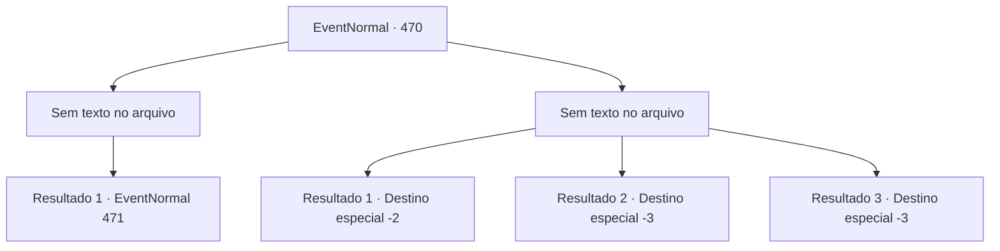

# Eventos normais · 470

[Índice da tabela](index.md) · [Índice geral](../index.md)

ID: `pt:EventNormal:470` · Fonte: `EventNormal4` · Versão: 1.2.47.

Mapeamento estático dos arquivos; a disponibilidade e a execução dependem do estado da run.

## Texto do evento

*Sem texto no arquivo.*

## Dados de entrada

```json
{
  "id": 470,
  "grade": 1,
  "place": "",
  "required": ""
}
```

## Mapa das escolhas



## Escolhas e resultados

### Escolha 1

*Sem texto no arquivo; o papel dessa opção depende da interface do jogo.*

Requisitos e outros campos da escolha:

```json
{
  "required": ""
}
```

#### Resultado 1.1


 "AHHHHH!"

 O último guarda cai com um grito. Schwain vê sua arma pingando sangue, e leva uma queda. 

 "P... por favor me poupe! {1}! Eu não preciso de nenhum ouro!"

 Schwain curva a cabeça para você, implorando pela vida.

Continuação registrada: [Evento 471](0471.md) na mesma tabela.

```json
{
  "required": "",
  "chance": "1",
  "nextEvent": 471,
  "type": 2,
  "reward": ""
}
```

### Escolha 2

*Sem texto no arquivo; o papel dessa opção depende da interface do jogo.*

Requisitos e outros campos da escolha:

```json
{
  "required": ""
}
```

#### Resultado 2.1

Os guardas se juntam e te derrubam sem piedade. Depois disso, eles roubam seu ouro e sobem na carruagem com Schwain. Você quase não consegue se recompor, muito tempo após eles irem.

Continuação registrada: [Destino especial `-2`](../destinos-especiais.md).

```json
{
  "required": "1_0_2|1_1_2",
  "chance": "1",
  "nextEvent": -2,
  "type": 2,
  "reward": "0_0_-1|0_1_-1|0_4_-400|5_339_10"
}
```

#### Resultado 2.2

Você perde sua vida para as lâminas dos guardas.

Continuação registrada: [Destino especial `-3`](../destinos-especiais.md).

```json
{
  "required": "2_0_2",
  "chance": "1",
  "nextEvent": -3,
  "type": 2,
  "reward": "0_0_-1|0_1_-1"
}
```

#### Resultado 2.3

Você perde sua vida para as lâminas dos guardas.

Continuação registrada: [Destino especial `-3`](../destinos-especiais.md).

```json
{
  "required": "2_1_2",
  "chance": "1",
  "nextEvent": -3,
  "type": 2,
  "reward": "0_0_-1|0_1_-1"
}
```

## Referências que chegam a este evento

- [Evento 469 · escolha 1 · resultado 3](0469.md#escolha-1)
- [Evento 469 · escolha 1 · resultado 4](0469.md#escolha-1)
- [Evento 469 · escolha 2 · resultado 1](0469.md#escolha-2)
