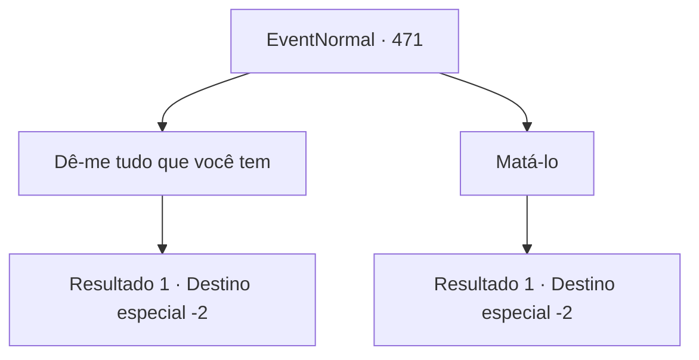

# Eventos normais · 471

[Índice da tabela](index.md) · [Índice geral](../index.md)

ID: `pt:EventNormal:471` · Fonte: `EventNormal4` · Versão: 1.2.47.

Mapeamento estático dos arquivos; a disponibilidade e a execução dependem do estado da run.

## Texto do evento

*Sem texto no arquivo.*

## Dados de entrada

```json
{
  "id": 471,
  "grade": 1,
  "place": "",
  "required": ""
}
```

## Mapa das escolhas



## Escolhas e resultados

### Escolha 1

Dê-me tudo que você tem

Requisitos e outros campos da escolha:

```json
{
  "required": ""
}
```

#### Resultado 1.1

Você ameaça Schwain a te trazer tudo que ele tem. Schwain te pede para esperar um pouco, então pega um baú na carruagem. 

 "I...isso é tudo que eu tenho no momento! Pegue!"

 Você abre o baú que ele trouxe. Há vários coisas dentro, mas as únicas que você poderia usar são duas poções. Você as pega e deixa o lugar.

Continuação registrada: [Destino especial `-2`](../destinos-especiais.md).

```json
{
  "required": "",
  "chance": "1",
  "nextEvent": -2,
  "type": 2,
  "reward": "0_3_-3|3_36_1|3_37_1|0_4_100|5_339_10"
}
```

### Escolha 2

Matá-lo

Requisitos e outros campos da escolha:

```json
{
  "required": "2_3_-14"
}
```

#### Resultado 2.1

Você tira a vida de Schwain. Ele cai com um olhar espanto. Você recolhe o que está na carruagem e deixa o lugar.

Continuação registrada: [Destino especial `-2`](../destinos-especiais.md).

```json
{
  "required": "",
  "chance": "1",
  "nextEvent": -2,
  "type": 2,
  "reward": "0_3_-10|5_339_10|3_36_1|3_37_1|0_4_100|0_2_1"
}
```

## Referências que chegam a este evento

- [Evento 470 · escolha 1 · resultado 1](0470.md#escolha-1)
