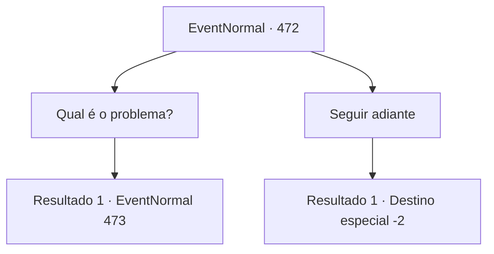

# Eventos normais · 472

[Índice da tabela](index.md) · [Índice geral](../index.md)

ID: `pt:EventNormal:472` · Fonte: `EventNormal4` · Versão: 1.2.47.

Mapeamento estático dos arquivos; a disponibilidade e a execução dependem do estado da run.

## Texto do evento

Sob o sol escaldante, os trabalhadores estão ocupados reparando as paredes arruinadas. Entre as pessoas trabalhadoras, você ouve um homem reclamando. 

 "Maldição! Não posso mostrar ISSO ao senhorio!"

 Ele caminha ao redor das muralhas da cidade, suando profusamente em uma cota de malha.

## Dados de entrada

```json
{
  "id": 472,
  "grade": 1,
  "place": "",
  "required": "5_343_0"
}
```

## Mapa das escolhas



## Escolhas e resultados

### Escolha 1

Qual é o problema?

Requisitos e outros campos da escolha:

```json
{
  "required": ""
}
```

#### Resultado 1.1

Você se aproxima do homem e pergunta o que está havendo. Ele se apresenta como 'Sergei', o comandante da companhia da cidade, e explica a situação. 

 "O senhorio ordenou a renovação dos muros da cidade dentro de um mês. Contudo, nós estamos com poucos trabalhadores e falta um arquiteto. Quase nenhum progressopor vários dias. *sigh*"

 Ele suspira e grita com os trabalhadores sem motivo. Os trabalhadores rapidamente carregam as pedras, como se pisassem em cascas de ovos.

Continuação registrada: [Evento 473](0473.md) na mesma tabela.

```json
{
  "required": "",
  "chance": "1",
  "nextEvent": 473,
  "type": 2,
  "reward": "5_343_9"
}
```

### Escolha 2

Seguir adiante

Requisitos e outros campos da escolha:

```json
{
  "required": ""
}
```

#### Resultado 2.1

Você olha para os trabalhadores suados e passa direto.

Continuação registrada: [Destino especial `-2`](../destinos-especiais.md).

```json
{
  "required": "",
  "chance": "1",
  "nextEvent": -2,
  "type": 2,
  "reward": "5_343_9"
}
```

## Referências que chegam a este evento

Nenhum `nextEvent` positivo da mesma tabela aponta para este nó. Isso não prova que seja inacessível: sorteio e estado de história podem selecioná-lo.

