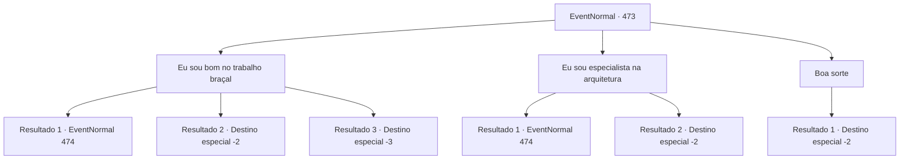

# Eventos normais · 473

[Índice da tabela](index.md) · [Índice geral](../index.md)

ID: `pt:EventNormal:473` · Fonte: `EventNormal4` · Versão: 1.2.47.

Mapeamento estático dos arquivos; a disponibilidade e a execução dependem do estado da run.

## Texto do evento

*Sem texto no arquivo.*

## Dados de entrada

```json
{
  "id": 473,
  "grade": 1,
  "place": "",
  "required": ""
}
```

## Mapa das escolhas



## Escolhas e resultados

### Escolha 1

Eu sou bom no trabalho braçal

Requisitos e outros campos da escolha:

```json
{
  "required": ""
}
```

#### Resultado 1.1

Sergei se alegra com as suas palavras corajosas. 

 "Esplêndido! Então você tentaria trabalhar aqui? Eu te pagarei bem."

 Ele te manda direto para o local da construção para trabalhar. Trabalho braçal é doloroso, mas o tempo voa, enquanto você trabalha incansavelmente.

 Graças ao seu esforço, a construção progride rapidamente e termina antes do esperado. Sergei te entrega o salário e fala. 

 "Excelente trabalho. Você sabe... O senhorio me disse para fortificar os portões também... O que você acha?"


Continuação registrada: [Evento 474](0474.md) na mesma tabela.

```json
{
  "required": "",
  "chance": "1|0_5_1",
  "nextEvent": 474,
  "type": 0,
  "reward": "0_2_1|0_4_60"
}
```

#### Resultado 1.2

Sergei se alegra com as suas palavras corajosas. 

 "Esplêndido! Então você tentaria trabalhar aqui? Eu te pagarei bem."

 Mas trabalhar no calor é extremamente árduo. Sofrendo de vertigem, você tropeça nos próprios pés. Você segura seu tornozelo inchado e desaba. Sergei chega perto de você e reclama. 

 "*sigh* Achei que você faria melhor! Pegue isso e ache outro trabalho."

 Ele se enfurerece com você, te joga uma pequena poção, e te expulsa.

Continuação registrada: [Destino especial `-2`](../destinos-especiais.md).

```json
{
  "required": "1_0_2",
  "chance": "13",
  "nextEvent": -2,
  "type": 1,
  "reward": "0_0_-1|3_190_1"
}
```

#### Resultado 1.3

Sergei se alegra com as suas palavras corajosas. 

 "Esplêndido! Então você tentaria trabalhar aqui? Eu te pagarei bem."

 Mas trabalhar no calor é extremamente árduo. Sofrendo de vertigem, você tropeça nos próprios pés. Você cai do muro e quebra o pescoço.

Continuação registrada: [Destino especial `-3`](../destinos-especiais.md).

```json
{
  "required": "2_0_2",
  "chance": "13",
  "nextEvent": -3,
  "type": 1,
  "reward": "0_0_-1"
}
```

### Escolha 2

Eu sou especialista na arquitetura

Requisitos e outros campos da escolha:

```json
{
  "required": ""
}
```

#### Resultado 2.1


 "Hmm...? Você pode dar uma olhada nisso?"

 O comandante da companhia te lança um olhar suspeito, então pega a planta dos muros da cidade. Você a examina devagar. Você modifica os detalhes irrealistas na planta, e recalcula a força de trabalho e materiais necessários para cada setor.

 Graças à sua sugestão, a construção progride rapidamente e termina antes do esperado. O comandante da companhia te entrega o salário e fala. 

 "Excelente trabalho. Você sabe... O senhorio me disse para fortificar os portões também... O que você acha?"


Continuação registrada: [Evento 474](0474.md) na mesma tabela.

```json
{
  "required": "",
  "chance": "1|0_7_1",
  "nextEvent": 474,
  "type": 0,
  "reward": "0_2_1|0_4_60"
}
```

#### Resultado 2.2


 "Hmm...? Você pode dar uma olhada nisso?"

 O comandante da companhia te lança um olhar suspeito, então pega a planta dos muros da cidade. Você a examina devagar. Você modifica os detalhes irrealistas na planta, e recalcula a força de trabalho e materiais necessários para cada setor.

 Após dias, o prazo que o senhorio determinou se aproxima. Apesar das sua sugestão, eles falham em terminar a construção a tempo. Você sai quietamente, ignorando os gritos do senhorio de cima dos muros.

Continuação registrada: [Destino especial `-2`](../destinos-especiais.md).

```json
{
  "required": "",
  "chance": "15",
  "nextEvent": -2,
  "type": 1,
  "reward": ""
}
```

### Escolha 3

Boa sorte

Requisitos e outros campos da escolha:

```json
{
  "required": ""
}
```

#### Resultado 3.1

Você o encoraja e sai. Você ouve as vozes dos trabalhadores suados de bem longe.

Continuação registrada: [Destino especial `-2`](../destinos-especiais.md).

```json
{
  "required": "",
  "chance": "1",
  "nextEvent": -2,
  "type": 2,
  "reward": ""
}
```

## Referências que chegam a este evento

- [Evento 472 · escolha 1 · resultado 1](0472.md#escolha-1)
