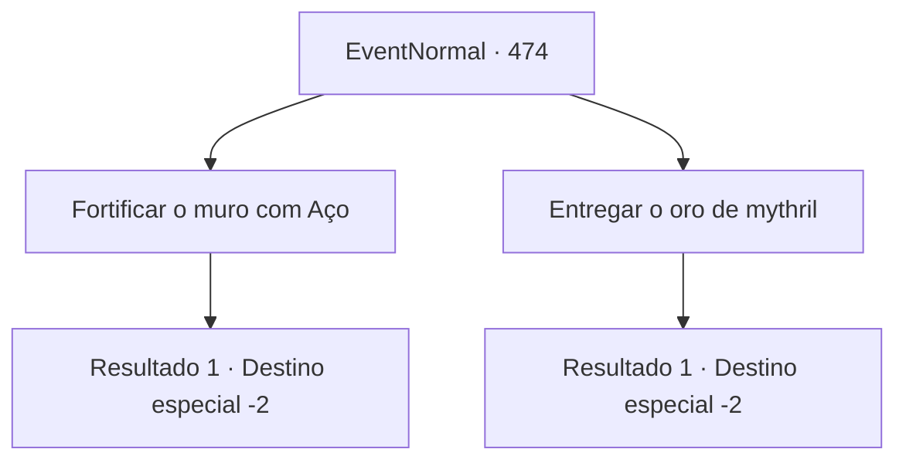

# Eventos normais · 474

[Índice da tabela](index.md) · [Índice geral](../index.md)

ID: `pt:EventNormal:474` · Fonte: `EventNormal4` · Versão: 1.2.47.

Mapeamento estático dos arquivos; a disponibilidade e a execução dependem do estado da run.

## Texto do evento

*Sem texto no arquivo.*

## Dados de entrada

```json
{
  "id": 474,
  "grade": 1,
  "place": "",
  "required": ""
}
```

## Mapa das escolhas



## Escolhas e resultados

### Escolha 1

Fortificar o muro com Aço

Requisitos e outros campos da escolha:

```json
{
  "required": ""
}
```

#### Resultado 1.1

Você o sugere fortificar o muro com aço. O comandante da companhia lambe os lábios e acena. 

 "Hmm... Isso soa certo. Obrigado por sua ajuda."

 Ele parte para recrutar mineradores de ferro. Você anda na direção oposta 

Continuação registrada: [Destino especial `-2`](../destinos-especiais.md).

```json
{
  "required": "",
  "chance": "1",
  "nextEvent": -2,
  "type": 2,
  "reward": "5_343_1"
}
```

### Escolha 2

Entregar o oro de mythril

Requisitos e outros campos da escolha:

```json
{
  "required": "8_129_1"
}
```

#### Resultado 2.1

Você o sugere fortificar o muro com mythril, e o entrega um minério de mythril. Os olhos do comandante da companhia arregalam, enquanto ele o recebe.  

 "P... posso mesmo ficar com ele? Obrigado! Eu vou ter que encontrar alguns técnicos agora mesmo."

 Com excitação, ele começa a procurar pelos anões no castelo.

Continuação registrada: [Destino especial `-2`](../destinos-especiais.md).

```json
{
  "required": "",
  "chance": "1",
  "nextEvent": -2,
  "type": 2,
  "reward": "4_129_1|0_3_3|5_343_2"
}
```

## Referências que chegam a este evento

- [Evento 473 · escolha 1 · resultado 1](0473.md#escolha-1)
- [Evento 473 · escolha 2 · resultado 1](0473.md#escolha-2)
