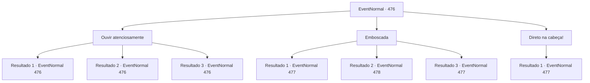

# Eventos normais · 476

[Índice da tabela](index.md) · [Índice geral](../index.md)

ID: `pt:EventNormal:476` · Fonte: `EventNormal4` · Versão: 1.2.47.

Mapeamento estático dos arquivos; a disponibilidade e a execução dependem do estado da run.

## Texto do evento

*Sem texto no arquivo.*

## Dados de entrada

```json
{
  "id": 476,
  "grade": 1,
  "place": "",
  "required": ""
}
```

## Mapa das escolhas



## Escolhas e resultados

### Escolha 1

Ouvir atenciosamente

Requisitos e outros campos da escolha:

```json
{
  "required": "5_344_0"
}
```

#### Resultado 1.1

Você ove cuidadosamente e sente algo. Você sente como se houvesse ao menos três ou mais criaturas em sua frente. Você também consegue identificar a localização aproxima deles.

Continuação registrada: [Evento 476](0476.md) na mesma tabela.

```json
{
  "required": "",
  "chance": "1|0_14_1",
  "nextEvent": 476,
  "type": 0,
  "reward": "5_344_1"
}
```

#### Resultado 1.2

Você ouve cuidadosamente, mas não sente nada. Provavelmente é só seu humor.

Continuação registrada: [Evento 476](0476.md) na mesma tabela.

```json
{
  "required": "20_2_0",
  "chance": "11",
  "nextEvent": 476,
  "type": 1,
  "reward": "5_344_2"
}
```

#### Resultado 1.3

Você ouve cuidadosamente, mas escuta só seu coração batendo de ansiedade.

Continuação registrada: [Evento 476](0476.md) na mesma tabela.

```json
{
  "required": "21_2_0",
  "chance": "22",
  "nextEvent": 476,
  "type": 1,
  "reward": "5_344_2"
}
```

### Escolha 2

Emboscada

Requisitos e outros campos da escolha:

```json
{
  "required": "5_344_1"
}
```

#### Resultado 2.1

Você anda silenciosamente, com precaução extra. Ao andar para um espaço levemente mais amplo, você vê os bugbears, como Sergei disse. Você se esgueira para perto deles de uma só vez, e consegue matar um. O resto deles puxam as armas em espanto. 

 "*snarl* Esse lugar é nosso, humano!"

 Os bugbears te avisam com sotaques estranhos. Sacudindo suas clavas, eles pulam em você.

Continuação registrada: [Evento 477](0477.md) na mesma tabela.

```json
{
  "required": "",
  "chance": "1|0_6_1",
  "nextEvent": 477,
  "type": 0,
  "reward": "6_2_144",
  "place": 6
}
```

#### Resultado 2.2

Você anda silenciosamente, com precaução extra. Ao andar para um espaço levemente mais amplo, você vê os bugbears, como Sergei disse. Você consegue se esgueirar para perto deles, um por um. Eles falham em notar sua presença até o último minuto. Após derrotar três bugbears, você se dirige para a parte mais profunda do túnel. 

 Após andar por um tempo, você escuta um gemido vindo de um carrinho. Dentro, um mineiro está deitado com uma expressão de dor. 

 "Uh...Urgh..."


Continuação registrada: [Evento 478](0478.md) na mesma tabela.

```json
{
  "required": "20_5_2",
  "chance": "1|0_6_1",
  "nextEvent": 478,
  "type": 0,
  "reward": "0_2_1"
}
```

#### Resultado 2.3

Você anda silenciosamente, com precaução extra. Ao andar para um espaço levemente mais amplo, você vê os bugbears, como Sergei disse. Eles sentem você se aproximando e sacam suas clavas. 

 "*snarl* Esse lugar é nosso, humano!"

 Os bugbears te avisam com sotaques estranhos. Sacudindo suas clavas, eles pulam em você.

Continuação registrada: [Evento 477](0477.md) na mesma tabela.

```json
{
  "required": "",
  "chance": "17",
  "nextEvent": 477,
  "type": 1,
  "reward": "6_0_144",
  "place": 6
}
```

### Escolha 3

Direto na cabeça!

Requisitos e outros campos da escolha:

```json
{
  "required": "5_344_2"
}
```

#### Resultado 3.1

Você bravamente dá um passa à frente, e encontra os bugbears em um espaço levemente mais amplo. 

 "*rosnado* Esse lugar é nosso, humano!"

 Os bugbears te avisam com sotaques estranhos. Sacudindo suas clavas, eles pulam em você.

Continuação registrada: [Evento 477](0477.md) na mesma tabela.

```json
{
  "required": "",
  "chance": "1",
  "nextEvent": 477,
  "type": 2,
  "reward": "6_3_144",
  "place": 6
}
```

## Referências que chegam a este evento

- [Evento 475 · escolha 1 · resultado 1](0475.md#escolha-1)
- [Evento 476 · escolha 1 · resultado 1](0476.md#escolha-1)
- [Evento 476 · escolha 1 · resultado 2](0476.md#escolha-1)
- [Evento 476 · escolha 1 · resultado 3](0476.md#escolha-1)
- [Evento 481 · escolha 1 · resultado 1](0481.md#escolha-1)
