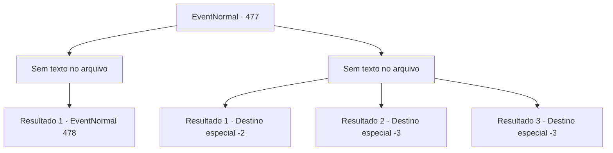

# Eventos normais · 477

[Índice da tabela](index.md) · [Índice geral](../index.md)

ID: `pt:EventNormal:477` · Fonte: `EventNormal4` · Versão: 1.2.47.

Mapeamento estático dos arquivos; a disponibilidade e a execução dependem do estado da run.

## Texto do evento

*Sem texto no arquivo.*

## Dados de entrada

```json
{
  "id": 477,
  "grade": 1,
  "place": "",
  "required": ""
}
```

## Mapa das escolhas



## Escolhas e resultados

### Escolha 1

*Sem texto no arquivo; o papel dessa opção depende da interface do jogo.*

Requisitos e outros campos da escolha:

```json
{
  "required": ""
}
```

#### Resultado 1.1

Você manda os bugbears para o submundo. Então se dirige para a parte mais profunda do túnel. 

 Após andar por um tempo, você escuta um gemido vindo de um carrinho. Dentro, um mineiro está deitado com uma expressão de dor. 

 "Uh...Urgh..."


Continuação registrada: [Evento 478](0478.md) na mesma tabela.

```json
{
  "required": "",
  "chance": "1",
  "nextEvent": 478,
  "type": 2,
  "reward": ""
}
```

### Escolha 2

*Sem texto no arquivo; o papel dessa opção depende da interface do jogo.*

Requisitos e outros campos da escolha:

```json
{
  "required": ""
}
```

#### Resultado 2.1

Você consegue esquivar do ataque dos bugbears, e foge o mais rápido que pode. Sergei, que estava te esperando lá fora, toca no seu ombro e fala. 

 "Obrigado por tentar... Eu sei que trabalhou duro. Isso não é muito, mas gaste na sua jornada."

 Você pega algum ouro e o deixa.

Continuação registrada: [Destino especial `-2`](../destinos-especiais.md).

```json
{
  "required": "1_0_2|1_1_2",
  "chance": "1",
  "nextEvent": -2,
  "type": 2,
  "reward": "0_0_-1|0_1_-1|5_343_9|0_4_25"
}
```

#### Resultado 2.2

Quando a clava de um bugbear bate em sua cabeça, você desaba. Sua visão embaça e as risadas deles ecoam em seus ouvidos.

Continuação registrada: [Destino especial `-3`](../destinos-especiais.md).

```json
{
  "required": "2_0_2",
  "chance": "1",
  "nextEvent": -3,
  "type": 2,
  "reward": "0_0_-1|0_1_-1"
}
```

#### Resultado 2.3

Quando a clava de um bugbear bate em sua cabeça, você desaba. Sua visão embaça e as risadas deles ecoam em seus ouvidos.

Continuação registrada: [Destino especial `-3`](../destinos-especiais.md).

```json
{
  "required": "2_1_2",
  "chance": "1",
  "nextEvent": -3,
  "type": 2,
  "reward": "0_0_-1|0_1_-1"
}
```

## Referências que chegam a este evento

- [Evento 476 · escolha 2 · resultado 1](0476.md#escolha-2)
- [Evento 476 · escolha 2 · resultado 3](0476.md#escolha-2)
- [Evento 476 · escolha 3 · resultado 1](0476.md#escolha-3)
