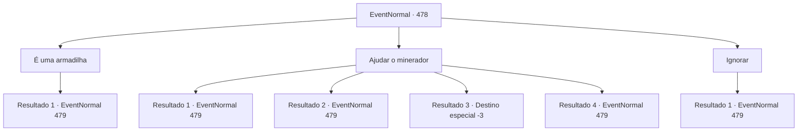

# Eventos normais · 478

[Índice da tabela](index.md) · [Índice geral](../index.md)

ID: `pt:EventNormal:478` · Fonte: `EventNormal4` · Versão: 1.2.47.

Mapeamento estático dos arquivos; a disponibilidade e a execução dependem do estado da run.

## Texto do evento

*Sem texto no arquivo.*

## Dados de entrada

```json
{
  "id": 478,
  "grade": 1,
  "place": "",
  "required": ""
}
```

## Mapa das escolhas



## Escolhas e resultados

### Escolha 1

É uma armadilha

Requisitos e outros campos da escolha:

```json
{
  "required": "1_14_14"
}
```

#### Resultado 1.1

Você nota que é uma armadilha para enganar pessoas. Você imediatamente olha ao redor e acha os bugbears se escondendo no escuro. Eles percebem que você viu através da trama deles. Eles sacam suas armas, gritam, e correm em sua direção. 

 "Morra, humano!!!"


Continuação registrada: [Evento 479](0479.md) na mesma tabela.

```json
{
  "required": "",
  "chance": "1",
  "nextEvent": 479,
  "type": 2,
  "reward": "6_0_144",
  "place": 6
}
```

### Escolha 2

Ajudar o minerador

Requisitos e outros campos da escolha:

```json
{
  "required": ""
}
```

#### Resultado 2.1

Você tenta ajudar o minerador no carrinho a se levantar. Então, uma rocha cai na sua cabeça. Mas ao invés de sua cabeça, a rocha quebra em pedaços com um som esmagador. Os bugbears escondidos saem com olhares de espanto. Eles sacam suas armas, gritam, e correm em sua direção. 

 "Morra, humano!!!"


Continuação registrada: [Evento 479](0479.md) na mesma tabela.

```json
{
  "required": "21_9_2",
  "chance": "1|0_13_1",
  "nextEvent": 479,
  "type": 0,
  "reward": "6_0_144",
  "place": 6
}
```

#### Resultado 2.2

Você tenta ajudar o mineiro no carrinho a se levantar. Então , uma rocha cai na sua cabeça. A rocha bate na sua cabeça com um som esmagador, e você sente uma dor terrível como se seus olhos estivessem prestes à cair. Os bugbears escondidos saem e correm em sua direção. 

 "Hahaha!! Morra, humano tolo!!!"


Continuação registrada: [Evento 479](0479.md) na mesma tabela.

```json
{
  "required": "21_9_2|1_0_2",
  "chance": "15",
  "nextEvent": 479,
  "type": 1,
  "reward": "0_0_-1|6_0_144",
  "place": 6
}
```

#### Resultado 2.3

Você tenta ajudar o mineiro a se levantar. Então, uma rocha cai na sua cabeça. Seu crânio se despedaça com um wom esmagador.

Continuação registrada: [Destino especial `-3`](../destinos-especiais.md).

```json
{
  "required": "21_9_2|2_0_2",
  "chance": "15",
  "nextEvent": -3,
  "type": 1,
  "reward": "0_0_-1"
}
```

#### Resultado 2.4

Você tenta ajudar o mineiro no carrinho a se levantar. Então, uma rocha cai na sua cabeça, mas você num reflexo a bloqueia. Os bugbears escondidos saem com olhares de espanto. Eles sacam suas armas, gritam, e correm em sua direção. 

 "Morra, humano!!!"


Continuação registrada: [Evento 479](0479.md) na mesma tabela.

```json
{
  "required": "20_9_2",
  "chance": "1",
  "nextEvent": 479,
  "type": 0,
  "reward": "6_0_144",
  "place": 6
}
```

### Escolha 3

Ignorar

Requisitos e outros campos da escolha:

```json
{
  "required": ""
}
```

#### Resultado 3.1

Você ignora o mineiro que geme e passa direto. No entanto, os bugbears escondidos saem e correm em sua direção. 

 "Morra, humano!!!"


Continuação registrada: [Evento 479](0479.md) na mesma tabela.

```json
{
  "required": "",
  "chance": "1",
  "nextEvent": 479,
  "type": 2,
  "reward": "6_0_144|5_345_1",
  "place": 6
}
```

## Referências que chegam a este evento

- [Evento 476 · escolha 2 · resultado 2](0476.md#escolha-2)
- [Evento 477 · escolha 1 · resultado 1](0477.md#escolha-1)
