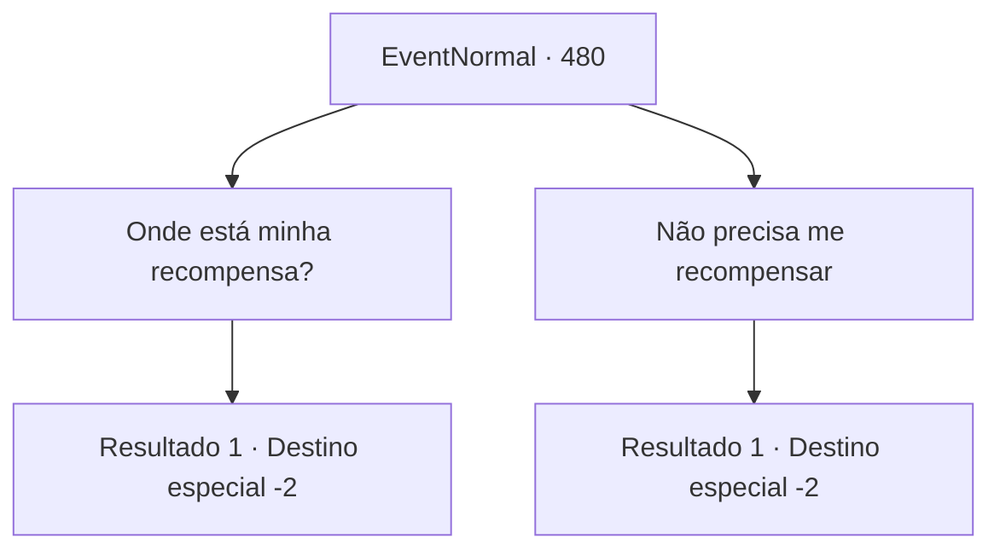

# Eventos normais · 480

[Índice da tabela](index.md) · [Índice geral](../index.md)

ID: `pt:EventNormal:480` · Fonte: `EventNormal4` · Versão: 1.2.47.

Mapeamento estático dos arquivos; a disponibilidade e a execução dependem do estado da run.

## Texto do evento

*Sem texto no arquivo.*

## Dados de entrada

```json
{
  "id": 480,
  "grade": 1,
  "place": "",
  "required": ""
}
```

## Mapa das escolhas



## Escolhas e resultados

### Escolha 1

Onde está minha recompensa?

Requisitos e outros campos da escolha:

```json
{
  "required": ""
}
```

#### Resultado 1.1

Por sua pergunta, Sergei te entrega uma bolsa de couro que ele te preparou. 

 "Aqui. Uma recompensa por se livrar daquelas criaturas. Obrigado pelo trabalho duro!"

  Ele toca em seu ombro algumas vezes, e vai embora com os homens dele.

Continuação registrada: [Destino especial `-2`](../destinos-especiais.md).

```json
{
  "required": "",
  "chance": "1",
  "nextEvent": -2,
  "type": 2,
  "reward": "5_343_9|0_4_50"
}
```

### Escolha 2

Não precisa me recompensar

Requisitos e outros campos da escolha:

```json
{
  "required": ""
}
```

#### Resultado 2.1

Você recusa a recompensa de Sergei, mesmo antes que ele ofereça. Ele fala com surpresa. 

 "É mesmo? Deveria haver mais pessoas como você. Muito obrigado..!"

 Ele toca em seu ombro algumas vezes, e vai embora com os homens dele.

Continuação registrada: [Destino especial `-2`](../destinos-especiais.md).

```json
{
  "required": "",
  "chance": "1",
  "nextEvent": -2,
  "type": 2,
  "reward": "5_343_9|0_3_5"
}
```

## Referências que chegam a este evento

- [Evento 479 · escolha 1 · resultado 1](0479.md#escolha-1)
- [Evento 479 · escolha 1 · resultado 2](0479.md#escolha-1)
