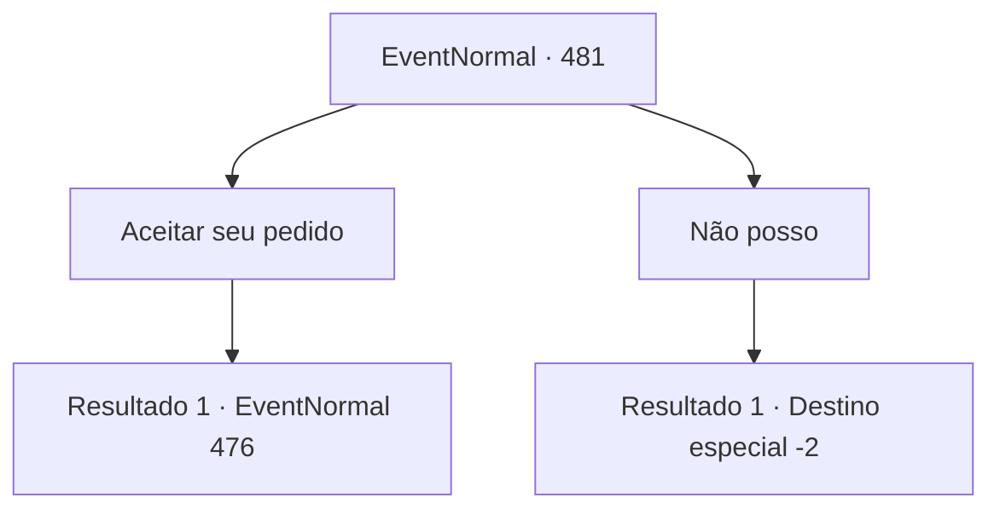

# Eventos normais · 481

[Índice da tabela](index.md) · [Índice geral](../index.md)

ID: `pt:EventNormal:481` · Fonte: `EventNormal4` · Versão: 1.2.47.

Mapeamento estático dos arquivos; a disponibilidade e a execução dependem do estado da run.

## Texto do evento

Você passa pela parede da cidade novamente, que estava em construção outro dia. Você vê que é construído corretamente, bem fazendo seu trabalho. O mythril está anexado a algumas partes do portão, no entanto, ainda parece precisar de melhorias. Naquele momento, o comandante da empresa, Sergei, reconhece você e o cumprimenta calorosamente. 

 "Poxa! Eu estava esperando por você. Precisa te perguntar algo urgentemente ..."

 Ele agarra sua mão e dá uma olhada desesperada. 

 "Eu tenho que minerar minério de ferro na ordem do meu Senhor. No entanto, os insetos venceram os trabalhadores até a morte e assumiram a mina. Você vai afastá -los?"


## Dados de entrada

```json
{
  "id": 481,
  "grade": 2,
  "place": "",
  "required": "5_343_2"
}
```

## Mapa das escolhas



## Escolhas e resultados

### Escolha 1

Aceitar seu pedido

Requisitos e outros campos da escolha:

```json
{
  "required": ""
}
```

#### Resultado 1.1

Você aceita o pedido de Sergei e parte para a mina, onde os bugbears foram vistos. A mina é meio perto do muro renovado. Há uma barricada na entrada, mas Sergei a remove para você. 

 "Eles são maus, então por favor tenha cuidado..."

 Você entra na mina ocupada pelos bugbears. Parece mais frio e úmido dentro do túnel do que fora. Ao andar pelo túnel, você escuta algo se mover.

Continuação registrada: [Evento 476](0476.md) na mesma tabela.

```json
{
  "required": "",
  "chance": "1",
  "nextEvent": 476,
  "type": 2,
  "reward": ""
}
```

### Escolha 2

Não posso

Requisitos e outros campos da escolha:

```json
{
  "required": ""
}
```

#### Resultado 2.1

Você recusa o pedido de Sergei de maneira indireta. Ele te deixa ir com um olhar de arrependimento.

Continuação registrada: [Destino especial `-2`](../destinos-especiais.md).

```json
{
  "required": "",
  "chance": "1",
  "nextEvent": -2,
  "type": 2,
  "reward": "5_343_9"
}
```

## Referências que chegam a este evento

Nenhum `nextEvent` positivo da mesma tabela aponta para este nó. Isso não prova que seja inacessível: sorteio e estado de história podem selecioná-lo.

