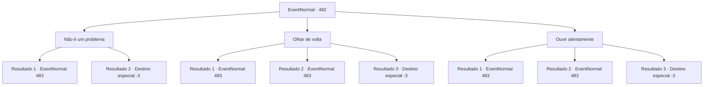

# Eventos normais · 482

[Índice da tabela](index.md) · [Índice geral](../index.md)

ID: `pt:EventNormal:482` · Fonte: `EventNormal4` · Versão: 1.2.47.

Mapeamento estático dos arquivos; a disponibilidade e a execução dependem do estado da run.

## Texto do evento

O pôr do sol traz a noite e o mercado, antes lotado, agora está deserto. Você anda por lá procurando por um lugar para passar a noite. Você sente que alguém está olhando para você.

## Dados de entrada

```json
{
  "id": 482,
  "grade": 1,
  "place": "",
  "required": "1_2_50|5_436_0"
}
```

## Mapa das escolhas



## Escolhas e resultados

### Escolha 1

Não é um problema

Requisitos e outros campos da escolha:

```json
{
  "required": "2_14_10"
}
```

#### Resultado 1.1

Você apenas anda pela rua, pensando que não é nada demais. E o preço de sua falta de cuidado é uma adaga nas suas costas. 

 "Não fique ressentido. Acabei de receber o pedido."

 Alguém que você não conhece sussurra no seu ouvido. Você se vira para identificar a pessoa que lhe atacou. Ele está vestindo um capuz preto, que deixa seu rosto invisível. 

 "Hmmm, não morreu ainda."

 O homem com o capuz preto pula de volta em você, corrigindo a adaga.

Continuação registrada: [Evento 483](0483.md) na mesma tabela.

```json
{
  "required": "1_0_2",
  "chance": "1",
  "nextEvent": 483,
  "type": 2,
  "reward": "6_0_48|0_0_-1|5_436_9",
  "place": 4
}
```

#### Resultado 1.2

Você apenas anda pela rua, pensando que não é nada demais. E o preço de sua falta de cuidado é uma adaga nas suas costas. 

 "Não fique ressentido. Acabei de receber o pedido."

 Alguém que você não conhece sussurra no seu ouvido. Com o sussurro, a adaga é retirada. Você cai no chão, sangrando.

Continuação registrada: [Destino especial `-3`](../destinos-especiais.md).

```json
{
  "required": "2_0_2",
  "chance": "1",
  "nextEvent": -3,
  "type": 2,
  "reward": "0_0_-1"
}
```

### Escolha 2

Olhar de volta

Requisitos e outros campos da escolha:

```json
{
  "required": "1_14_10"
}
```

#### Resultado 2.1

Você rapidamente olha para trás e encontra um assassino com um capuz preto. 

 "Mas que velocidade...!"

 Logo ao fazer contato visual com você, ele corre na sua direção com uma adaga.

Continuação registrada: [Evento 483](0483.md) na mesma tabela.

```json
{
  "required": "",
  "chance": "1|0_6_1",
  "nextEvent": 483,
  "type": 0,
  "reward": "6_0_48|5_436_9",
  "place": 4
}
```

#### Resultado 2.2

Você olha para trás no momento em que a adaga voa para o seu corpo. Um homem com um capuz preto atacou você. Você sangra e empurra o homem para longe. 

 "Não fique ressentido. Acabei de receber o pedido."

 Ele ataca você novamente, corrigindo a adaga.

Continuação registrada: [Evento 483](0483.md) na mesma tabela.

```json
{
  "required": "1_0_2",
  "chance": "16",
  "nextEvent": 483,
  "type": 1,
  "reward": "6_0_48|0_0_-1|5_436_9",
  "place": 4
}
```

#### Resultado 2.3

Você olha para trás no momento em que a adaga voa para o seu corpo. Um homem com um capuz preto atacou você. Você sangra e empurra o homem para longe. 

 "É tarde demais. Você já está morto."

 As palavras dele ecoam nos seus ouvidos, seus olhos reviram. No fim, você perde a consciência e cai.

Continuação registrada: [Destino especial `-3`](../destinos-especiais.md).

```json
{
  "required": "2_0_2",
  "chance": "16",
  "nextEvent": -3,
  "type": 2,
  "reward": "0_0_-1"
}
```

### Escolha 3

Ouvir atentamente

Requisitos e outros campos da escolha:

```json
{
  "required": "1_14_10"
}
```

#### Resultado 3.1

Você se concentra e ouve os sons ao seu redor. Então você sente a respiração de alguém e o ouve chegando mais perto. Você rola para frente e esquiva do ataque por trás. Então você vira sua cabeça e vê o assassino com o capuz preto. 

 "Mas que velocidade...!"

 Logo ao fazer contato visual com você, ele corre na sua direção com uma adaga.

Continuação registrada: [Evento 483](0483.md) na mesma tabela.

```json
{
  "required": "",
  "chance": "1|0_14_1",
  "nextEvent": 483,
  "type": 0,
  "reward": "6_0_48|5_436_9",
  "place": 4
}
```

#### Resultado 3.2

Você se concentra e ouve os sons ao seu redor. Mas você não nota nada, então você continua andando. Nesse momento, uma adaga afiada atinge suas costas. 

 "Não fique ressentido. Acabei de receber o pedido."

 Alguém que você não conhece sussurra no seu ouvido.  Você se vira para identificar a pessoa que lhe atacou.  Ele está vestindo um capuz preto, que deixa seu rosto invisível.  

 "Hmmm, não morreu ainda."

  O homem com o capuz preto pula de volta em você, corrigindo a adaga.

Continuação registrada: [Evento 483](0483.md) na mesma tabela.

```json
{
  "required": "1_0_2",
  "chance": "16",
  "nextEvent": 483,
  "type": 1,
  "reward": "6_0_48|0_0_-1|5_436_9",
  "place": 4
}
```

#### Resultado 3.3

Você concentrou-se e inclinou os ouvidos para os sons ao seu redor. No entanto, como não sentiu nada, você deu um passo à frente. Nesse momento, uma adaga afiada foi cravada em suas costas. 

 "Não me culpe tanto. Fui apenas contratado."

 sussurrou alguém desconhecido em seu ouvido. Com esse sussurro, a adaga foi retirada, e você caiu no chão, derramando seu sangue.

Continuação registrada: [Destino especial `-3`](../destinos-especiais.md).

```json
{
  "required": "2_0_2",
  "chance": "16",
  "nextEvent": -3,
  "type": 1,
  "reward": "0_0_-1"
}
```

## Referências que chegam a este evento

Nenhum `nextEvent` positivo da mesma tabela aponta para este nó. Isso não prova que seja inacessível: sorteio e estado de história podem selecioná-lo.

