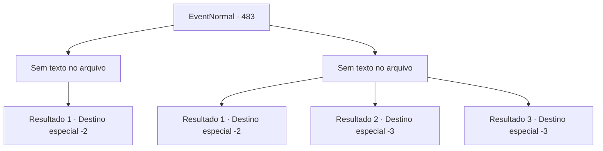

# Eventos normais · 483

[Índice da tabela](index.md) · [Índice geral](../index.md)

ID: `pt:EventNormal:483` · Fonte: `EventNormal4` · Versão: 1.2.47.

Mapeamento estático dos arquivos; a disponibilidade e a execução dependem do estado da run.

## Texto do evento

*Sem texto no arquivo.*

## Dados de entrada

```json
{
  "id": 483,
  "grade": 1,
  "place": "",
  "required": ""
}
```

## Mapa das escolhas



## Escolhas e resultados

### Escolha 1

*Sem texto no arquivo; o papel dessa opção depende da interface do jogo.*

Requisitos e outros campos da escolha:

```json
{
  "required": ""
}
```

#### Resultado 1.1

O assassino que foi derrotado por você já havia tirado a própria vida antes mesmo de você ter a chance de perguntar qualquer coisa. Você deixou o corpo dele para trás e saiu do mercado.

Continuação registrada: [Destino especial `-2`](../destinos-especiais.md).

```json
{
  "required": "",
  "chance": "1",
  "nextEvent": -2,
  "type": 2,
  "reward": "5_436_9"
}
```

### Escolha 2

*Sem texto no arquivo; o papel dessa opção depende da interface do jogo.*

Requisitos e outros campos da escolha:

```json
{
  "required": ""
}
```

#### Resultado 2.1

Você foi atingido pelo ataque do assassino e caiu no chão. Enquanto ele se aproximava de você com um sorriso malicioso, você rapidamente pegou um punhado de areia e jogou em seus olhos. 

 "Arghh!! Maldito!!!"

 O assassino esfregou os olhos e recuou, e você aproveitou a oportunidade para fugir.

Continuação registrada: [Destino especial `-2`](../destinos-especiais.md).

```json
{
  "required": "1_0_2|1_1_2",
  "chance": "1",
  "nextEvent": -2,
  "type": 2,
  "reward": "0_0_-1|0_1_-1|5_436_9"
}
```

#### Resultado 2.2

Você foi atacado pelo assassino e caiu no chão. O assassino se aproximou de você com um sorriso maligno. 

 "Tchauzinho."

 Com esse sussurro, a lâmina perfurou o seu pescoço.

Continuação registrada: [Destino especial `-3`](../destinos-especiais.md).

```json
{
  "required": "2_0_2",
  "chance": "1",
  "nextEvent": -3,
  "type": 2,
  "reward": "0_0_-1|0_1_-1"
}
```

#### Resultado 2.3

Você foi derrubado pelo ataque do assassino e caiu no chão. O assassino se aproximou de você com um sorriso sinistro. 

 "Durma Bem."

 Com esse sussurro, a adaga atravessou seu pescoço.

Continuação registrada: [Destino especial `-3`](../destinos-especiais.md).

```json
{
  "required": "2_1_2",
  "chance": "1",
  "nextEvent": -3,
  "type": 2,
  "reward": "0_0_-1|0_1_-1"
}
```

## Referências que chegam a este evento

- [Evento 482 · escolha 1 · resultado 1](0482.md#escolha-1)
- [Evento 482 · escolha 2 · resultado 1](0482.md#escolha-2)
- [Evento 482 · escolha 2 · resultado 2](0482.md#escolha-2)
- [Evento 482 · escolha 3 · resultado 1](0482.md#escolha-3)
- [Evento 482 · escolha 3 · resultado 2](0482.md#escolha-3)
