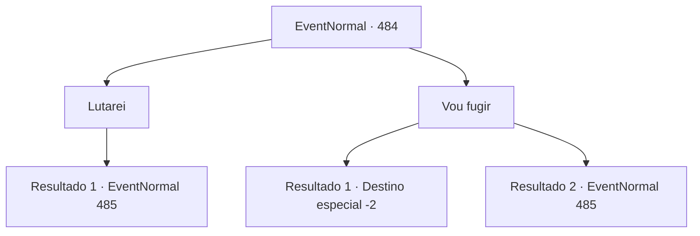

# Eventos normais · 484

[Índice da tabela](index.md) · [Índice geral](../index.md)

ID: `pt:EventNormal:484` · Fonte: `EventNormal4` · Versão: 1.2.47.

Mapeamento estático dos arquivos; a disponibilidade e a execução dependem do estado da run.

## Texto do evento

O sol se pôs e a escuridão se instalou. Você estava prestes a fechar os olhos por um momento para acender o fogo e preparar a barraca. No entanto, de alguma forma, um cheiro pungente de cadáver invadiu o ar. Você rapidamente examinou o ambiente e avistou pupilas brilhantes na escuridão. 

 "Aaaahh!"

 Era um 'Alma Penada'. O cadáver em movimento tentou cumprimentá-lo efusivamente, na tentativa de fazer de você seu companheiro.

## Dados de entrada

```json
{
  "id": 484,
  "grade": 1,
  "place": "",
  "required": "5_437_0"
}
```

## Mapa das escolhas



## Escolhas e resultados

### Escolha 1

Lutarei

Requisitos e outros campos da escolha:

```json
{
  "required": ""
}
```

#### Resultado 1.1

A criatura correu para você sem hesitar. Em frente à fogueira, uma luta entre você e o cadáver começou.

Continuação registrada: [Evento 485](0485.md) na mesma tabela.

```json
{
  "required": "",
  "chance": "1",
  "nextEvent": 485,
  "type": 2,
  "reward": "6_0_89|5_437_9",
  "place": 14
}
```

### Escolha 2

Vou fugir

Requisitos e outros campos da escolha:

```json
{
  "required": ""
}
```

#### Resultado 2.1

Você rapidamente se virou e escapou do Wight. Eles correram em sua direção com raiva e gritos, mas seus corpos deteriorados os impediram de te alcançar.

Continuação registrada: [Destino especial `-2`](../destinos-especiais.md).

```json
{
  "required": "",
  "chance": "1|0_6_1",
  "nextEvent": -2,
  "type": 0,
  "reward": "5_437_9"
}
```

#### Resultado 2.2

Você se virou e escapou do Wight, mas ele continuou correndo ferozmente em sua direção. Surpreendentemente, ele bloqueou seu caminho com uma velocidade surpreendente. Em seguida, ele empurrou seus dentes deteriorados e apodrecidos em sua direção.

Continuação registrada: [Evento 485](0485.md) na mesma tabela.

```json
{
  "required": "",
  "chance": "11",
  "nextEvent": 485,
  "type": 1,
  "reward": "6_0_89|5_437_9",
  "place": 14
}
```

## Referências que chegam a este evento

Nenhum `nextEvent` positivo da mesma tabela aponta para este nó. Isso não prova que seja inacessível: sorteio e estado de história podem selecioná-lo.

