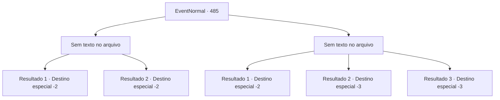

# Eventos normais · 485

[Índice da tabela](index.md) · [Índice geral](../index.md)

ID: `pt:EventNormal:485` · Fonte: `EventNormal4` · Versão: 1.2.47.

Mapeamento estático dos arquivos; a disponibilidade e a execução dependem do estado da run.

## Texto do evento

*Sem texto no arquivo.*

## Dados de entrada

```json
{
  "id": 485,
  "grade": 1,
  "place": "",
  "required": ""
}
```

## Mapa das escolhas



## Escolhas e resultados

### Escolha 1

*Sem texto no arquivo; o papel dessa opção depende da interface do jogo.*

Requisitos e outros campos da escolha:

```json
{
  "required": ""
}
```

#### Resultado 1.1

Depois de derrubar o Wight, você percebeu que o lugar onde você estava prestes a descansar era próximo a uma sepultura profanada. Não havia nada de valor no túmulo revirado. Você arrumou suas coisas e seguiu para outro lugar em busca de descanso.

Continuação registrada: [Destino especial `-2`](../destinos-especiais.md).

```json
{
  "required": "",
  "chance": "1",
  "nextEvent": -2,
  "type": 2,
  "reward": ""
}
```

#### Resultado 1.2

Após derrotar o Wight, você percebeu que o lugar onde pretendia descansar estava próximo a uma sepultura profanada. Você encontrou um pouco de ouro na sepultura revirada. Pegou o ouro e arrumou suas coisas para seguir para outro lugar em busca de descanso.

Continuação registrada: [Destino especial `-2`](../destinos-especiais.md).

```json
{
  "required": "",
  "chance": "1",
  "nextEvent": -2,
  "type": 2,
  "reward": "0_4_10"
}
```

### Escolha 2

*Sem texto no arquivo; o papel dessa opção depende da interface do jogo.*

Requisitos e outros campos da escolha:

```json
{
  "required": ""
}
```

#### Resultado 2.1

Você conseguiu escapar da criatura. E então o lugar onde você costumava dormir, Podia-se ver que estava perto da cova cavada.

Continuação registrada: [Destino especial `-2`](../destinos-especiais.md).

```json
{
  "required": "1_0_2|1_1_2",
  "chance": "1",
  "nextEvent": -2,
  "type": 2,
  "reward": "0_0_-1|0_1_-1"
}
```

#### Resultado 2.2

As presas podres de uma criatura mordem sua nuca. O sangue jorrou e você caiu no chão. E à medida que a infecção se espalha, Você fica Inconsciente.

Continuação registrada: [Destino especial `-3`](../destinos-especiais.md).

```json
{
  "required": "2_0_2",
  "chance": "1",
  "nextEvent": -3,
  "type": 2,
  "reward": "0_0_-1|0_1_-1"
}
```

#### Resultado 2.3

As presas podres de uma criatura mordem sua nuca. O sangue jorrou e você caiu no chão. E à medida que a infecção se espalha, Você fica Inconsciente.

Continuação registrada: [Destino especial `-3`](../destinos-especiais.md).

```json
{
  "required": "2_1_2",
  "chance": "1",
  "nextEvent": -3,
  "type": 2,
  "reward": "0_0_-1|0_1_-1"
}
```

## Referências que chegam a este evento

- [Evento 484 · escolha 1 · resultado 1](0484.md#escolha-1)
- [Evento 484 · escolha 2 · resultado 2](0484.md#escolha-2)
