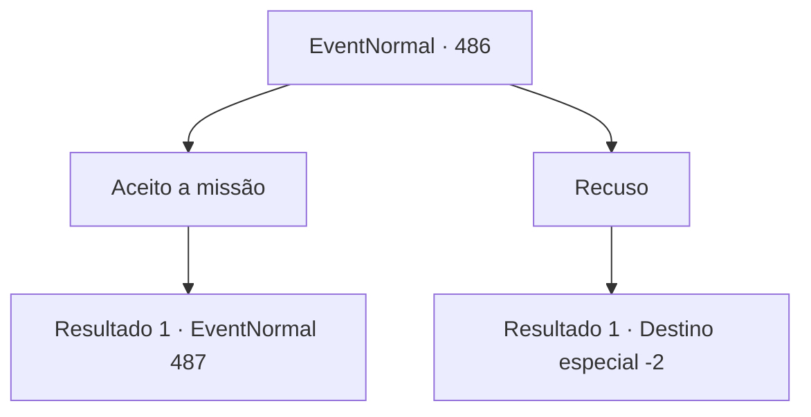

# Eventos normais · 486

[Índice da tabela](index.md) · [Índice geral](../index.md)

ID: `pt:EventNormal:486` · Fonte: `EventNormal4` · Versão: 1.2.47.

Mapeamento estático dos arquivos; a disponibilidade e a execução dependem do estado da run.

## Texto do evento

Você estava atravessando uma vasta planície onde campos de trigo se estendiam. Nesse momento, uma mulher de meia-idade se aproximou de você do outro lado e começou a falar. 

 "Oh, aventureiro! Temos um monstro em nossa vila. Por favor, nos ajude a expulsar essa terrível criatura."

 O rosto dela estava cheio de medo.

## Dados de entrada

```json
{
  "id": 486,
  "grade": 1,
  "place": "",
  "required": "5_438_0|1_2_35"
}
```

## Mapa das escolhas



## Escolhas e resultados

### Escolha 1

Aceito a missão

Requisitos e outros campos da escolha:

```json
{
  "required": ""
}
```

#### Resultado 1.1

Você seguiu em direção à vila indicada pela mulher de meia-idade. Lá, encontrou uma pequena vila com campos de trigo se estendendo e pequenas casas espalhadas. O trigo verde, que crescia até a altura de seus joelhos, balançava ao vento. No meio deles, você avistou uma enorme criatura semelhante a um humano, conhecida como 'Gigante das Colinas'. O Gigante das Colinas permanecia no campo de trigo, olhando ao redor com curiosidade.

Continuação registrada: [Evento 487](0487.md) na mesma tabela.

```json
{
  "required": "",
  "chance": "1",
  "nextEvent": 487,
  "type": 2,
  "reward": "5_438_1"
}
```

### Escolha 2

Recuso

Requisitos e outros campos da escolha:

```json
{
  "required": ""
}
```

#### Resultado 2.1

Você recusou o pedido da mulher de meia-idade. Ela parecia perturbada e partiu em busca de outra pessoa, com uma expressão de desespero em seu rosto.

Continuação registrada: [Destino especial `-2`](../destinos-especiais.md).

```json
{
  "required": "",
  "chance": "1",
  "nextEvent": -2,
  "type": 2,
  "reward": "5_438_9"
}
```

## Referências que chegam a este evento

Nenhum `nextEvent` positivo da mesma tabela aponta para este nó. Isso não prova que seja inacessível: sorteio e estado de história podem selecioná-lo.

