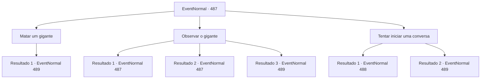

# Eventos normais · 487

[Índice da tabela](index.md) · [Índice geral](../index.md)

ID: `pt:EventNormal:487` · Fonte: `EventNormal4` · Versão: 1.2.47.

Mapeamento estático dos arquivos; a disponibilidade e a execução dependem do estado da run.

## Texto do evento

*Sem texto no arquivo.*

## Dados de entrada

```json
{
  "id": 487,
  "grade": 1,
  "place": "",
  "required": ""
}
```

## Mapa das escolhas



## Escolhas e resultados

### Escolha 1

Matar um gigante

Requisitos e outros campos da escolha:

```json
{
  "required": ""
}
```

#### Resultado 1.1

Você se aproximou do gigante enquanto brandia sua espada. O gigante percebeu sua presença hostil e brandiu seu porrete.

Continuação registrada: [Evento 489](0489.md) na mesma tabela.

```json
{
  "required": "",
  "chance": "1",
  "nextEvent": 489,
  "type": 2,
  "reward": "6_0_132",
  "place": 0
}
```

### Escolha 2

Observar o gigante

Requisitos e outros campos da escolha:

```json
{
  "required": "5_439_0"
}
```

#### Resultado 2.1

Você se escondeu entre as fileiras de trigo e observou calmamente as ações do gigante. O gigante não percebeu sua presença e continuou a percorrer o campo, verificando o estado do trigo. Ele arrancou as ervas daninhas e agitou os braços para espantar os pássaros.

Continuação registrada: [Evento 487](0487.md) na mesma tabela.

```json
{
  "required": "21_5_1",
  "chance": "1|0_6_1",
  "nextEvent": 487,
  "type": 0,
  "reward": "5_439_1"
}
```

#### Resultado 2.2

Você se escondeu entre as hastes de trigo e observou atentamente as ações do gigante. O gigante permaneceu completamente alheio à sua presença, enquanto percorria o campo inspecionando o estado das plantas. Ele cuidadosamente arrancou as ervas daninhas que cresciam ao redor e balançou os braços para afugentar os pássaros que se aproximavam.

Continuação registrada: [Evento 487](0487.md) na mesma tabela.

```json
{
  "required": "20_5_1",
  "chance": "1",
  "nextEvent": 487,
  "type": 2,
  "reward": "5_439_1"
}
```

#### Resultado 2.3

Você se escondeu entre as hastes de trigo e observou cautelosamente as ações do gigante. No entanto, o gigante percebeu sua presença e retirou sua clava. 

 "Humano! Saia imediatamente do campo!"

 Falando com raiva, brandindo sua clava.

Continuação registrada: [Evento 489](0489.md) na mesma tabela.

```json
{
  "required": "21_5_1",
  "chance": "13",
  "nextEvent": 489,
  "type": 1,
  "reward": "6_0_132",
  "place": 0
}
```

### Escolha 3

Tentar iniciar uma conversa

Requisitos e outros campos da escolha:

```json
{
  "required": "5_439_1"
}
```

#### Resultado 3.1

Você se aproximou do gigante e tentou iniciar uma conversa. Enquanto ele arrancava as ervas daninhas, ele virou a cabeça em sua direção em resposta ao seu chamado. 

 "Hmm? Qual é o assunto, humano?"


Continuação registrada: [Evento 488](0488.md) na mesma tabela.

```json
{
  "required": "21_1_2",
  "chance": "1",
  "nextEvent": 488,
  "type": 2,
  "reward": ""
}
```

#### Resultado 3.2

Você tentou se aproximar de um gigante e iniciar uma conversa. Enquanto arrancava ervas daninhas, o gigante virou a cabeça em resposta ao seu chamado. Em seguida, ele pegou um porrete. 

 "Crack...! Parece que você é realmente irritante. Saia imediatamente do campo!"

 Ele ficou muito excitado e balançou o porrete.

Continuação registrada: [Evento 489](0489.md) na mesma tabela.

```json
{
  "required": "20_1_2",
  "chance": "1",
  "nextEvent": 489,
  "type": 2,
  "reward": "6_0_132",
  "place": 0
}
```

## Referências que chegam a este evento

- [Evento 486 · escolha 1 · resultado 1](0486.md#escolha-1)
- [Evento 487 · escolha 2 · resultado 1](0487.md#escolha-2)
- [Evento 487 · escolha 2 · resultado 2](0487.md#escolha-2)
