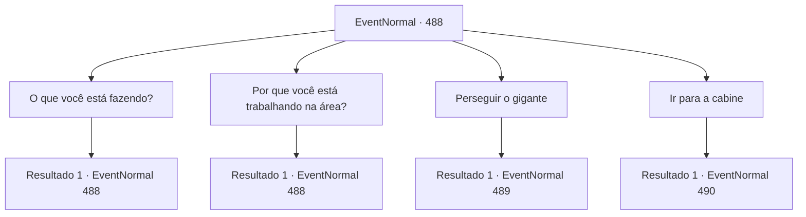

# Eventos normais · 488

[Índice da tabela](index.md) · [Índice geral](../index.md)

ID: `pt:EventNormal:488` · Fonte: `EventNormal4` · Versão: 1.2.47.

Mapeamento estático dos arquivos; a disponibilidade e a execução dependem do estado da run.

## Texto do evento

*Sem texto no arquivo.*

## Dados de entrada

```json
{
  "id": 488,
  "grade": 1,
  "place": "",
  "required": ""
}
```

## Mapa das escolhas



## Escolhas e resultados

### Escolha 1

O que você está fazendo?

Requisitos e outros campos da escolha:

```json
{
  "required": "5_440_0"
}
```

#### Resultado 1.1


 "Pode não parecer, mas estou cuidando deste campo. Arrancando ervas, fertilizando e espantando pássaros enquanto falo."

 Enquanto o gigante falava, ele continuou balançando as mãos para espantar os pássaros. Em seguida, ele disse para você ir embora se não tivesse nada para fazer, pois estava ocupado.

Continuação registrada: [Evento 488](0488.md) na mesma tabela.

```json
{
  "required": "",
  "chance": "1",
  "nextEvent": 488,
  "type": 2,
  "reward": "5_440_1"
}
```

### Escolha 2

Por que você está trabalhando na área?

Requisitos e outros campos da escolha:

```json
{
  "required": "5_440_1"
}
```

#### Resultado 2.1

O gigante mostrou estar irritado diante da sua pergunta. No entanto, apesar disso, ele respondeu à sua pergunta. 

 "É o campo do meu amigo, Ele me pediu para cuidar por ele."

 Se você não acredita, ele sugeriu que fosse lá pessoalmente e perguntasse, apontando com a mão para uma pequena cabana ao lado do moinho de vento. 

 "Lá. Ao lado do moinho de vento é a casa do meu amigo."


Continuação registrada: [Evento 488](0488.md) na mesma tabela.

```json
{
  "required": "",
  "chance": "1",
  "nextEvent": 488,
  "type": 2,
  "reward": "5_440_2"
}
```

### Escolha 3

Perseguir o gigante

Requisitos e outros campos da escolha:

```json
{
  "required": ""
}
```

#### Resultado 3.1

Como solicitado pela mulher de meia-idade, você decidiu expulsar o gigante da vila. Quando você pediu ao gigante para sair da vila, ele balançou a cabeça negativamente. 

 "Quem você pensa que é? A pessoa que deve sair é você. Saia imediatamente do campo!"

 Ele ficou muito excitado e balançou o porrete.

Continuação registrada: [Evento 489](0489.md) na mesma tabela.

```json
{
  "required": "",
  "chance": "1",
  "nextEvent": 489,
  "type": 2,
  "reward": "6_0_132",
  "place": 0
}
```

### Escolha 4

Ir para a cabine

Requisitos e outros campos da escolha:

```json
{
  "required": "5_440_2"
}
```

#### Resultado 4.1

Você se dirigiu à cabana ao lado do moinho de vento. Ao bater na porta, a porta velha rangia e se abria com dificuldade. 

 "Quem está aí...?"

 Enquanto a porta se abria, um homem idoso apareceu. O velho tinha a cabeça calva, os braços e o tronco eram robustos, mas suas pernas eram finas. Por isso, ele apoiava-se em uma bengala e parecia estar de pé com dificuldade.

Continuação registrada: [Evento 490](0490.md) na mesma tabela.

```json
{
  "required": "",
  "chance": "1",
  "nextEvent": 490,
  "type": 2,
  "reward": ""
}
```

## Referências que chegam a este evento

- [Evento 487 · escolha 3 · resultado 1](0487.md#escolha-3)
- [Evento 488 · escolha 1 · resultado 1](0488.md#escolha-1)
- [Evento 488 · escolha 2 · resultado 1](0488.md#escolha-2)
