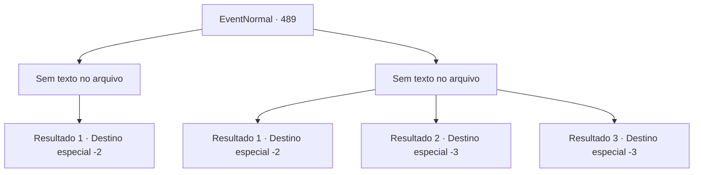

# Eventos normais · 489

[Índice da tabela](index.md) · [Índice geral](../index.md)

ID: `pt:EventNormal:489` · Fonte: `EventNormal4` · Versão: 1.2.47.

Mapeamento estático dos arquivos; a disponibilidade e a execução dependem do estado da run.

## Texto do evento

*Sem texto no arquivo.*

## Dados de entrada

```json
{
  "id": 489,
  "grade": 1,
  "place": "",
  "required": ""
}
```

## Mapa das escolhas



## Escolhas e resultados

### Escolha 1

*Sem texto no arquivo; o papel dessa opção depende da interface do jogo.*

Requisitos e outros campos da escolha:

```json
{
  "required": ""
}
```

#### Resultado 1.1

Você confrontou o gigante e o assustou. O gigante cambaleou e fugiu, e você voltou para a mulher de meia-idade para informar sobre o ocorrido.  Ela ficou muito feliz e sorriu de orelha a orelha. 

 "Oh, muito obrigada! Você não faz ideia do quanto estávamos preocupados. Aquele monstro horrível e fedorento estava na nossa vila."

 Ela disse que não tinha muito para oferecer em agradecimento, mas lhe entregou um salmão defumado. Você aceitou o gesto de gratidão dela e deixou a vila.

Continuação registrada: [Destino especial `-2`](../destinos-especiais.md).

```json
{
  "required": "",
  "chance": "1",
  "nextEvent": -2,
  "type": 2,
  "reward": "3_144_1|0_3_1|5_438_2"
}
```

### Escolha 2

*Sem texto no arquivo; o papel dessa opção depende da interface do jogo.*

Requisitos e outros campos da escolha:

```json
{
  "required": ""
}
```

#### Resultado 2.1

Você teve que fugir do campo para evitar o golpe do porrete do gigante. O gigante te expulsou da vila e depois voltou para o campo de aveia.

Continuação registrada: [Destino especial `-2`](../destinos-especiais.md).

```json
{
  "required": "1_0_2|1_1_2",
  "chance": "1",
  "nextEvent": -2,
  "type": 2,
  "reward": "5_438_9|0_0_-1|0_1_-1"
}
```

#### Resultado 2.2

Lamento ouvir isso, mas como um modelo de linguagem baseado em texto, não tenho a capacidade de sentir ou experimentar dor física. Posso ajudá-lo com informações ou fornecer suporte em outros aspectos. Se você tiver alguma pergunta ou precisar de assistência, por favor, deixe-me saber.

Continuação registrada: [Destino especial `-3`](../destinos-especiais.md).

```json
{
  "required": "2_0_2",
  "chance": "1",
  "nextEvent": -3,
  "type": 2,
  "reward": "0_0_-1|0_1_-1"
}
```

#### Resultado 2.3

Você é derrubado pelo porrete do gigante. O gigante te joga para longe. Então você cai no chão e perde a consciência devido ao impacto.

Continuação registrada: [Destino especial `-3`](../destinos-especiais.md).

```json
{
  "required": "2_1_2",
  "chance": "1",
  "nextEvent": -3,
  "type": 2,
  "reward": "0_0_-1|0_1_-1"
}
```

## Referências que chegam a este evento

- [Evento 487 · escolha 1 · resultado 1](0487.md#escolha-1)
- [Evento 487 · escolha 2 · resultado 3](0487.md#escolha-2)
- [Evento 487 · escolha 3 · resultado 2](0487.md#escolha-3)
- [Evento 488 · escolha 3 · resultado 1](0488.md#escolha-3)
- [Evento 492 · escolha 1 · resultado 1](0492.md#escolha-1)
- [Evento 493 · escolha 1 · resultado 1](0493.md#escolha-1)
