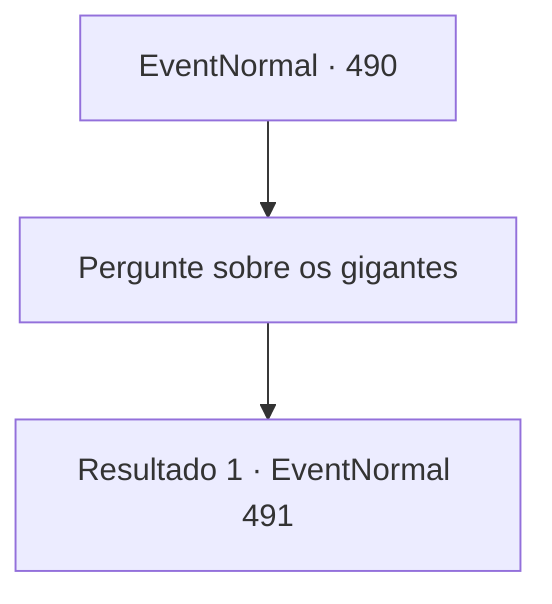

# Eventos normais · 490

[Índice da tabela](index.md) · [Índice geral](../index.md)

ID: `pt:EventNormal:490` · Fonte: `EventNormal4` · Versão: 1.2.47.

Mapeamento estático dos arquivos; a disponibilidade e a execução dependem do estado da run.

## Texto do evento

*Sem texto no arquivo.*

## Dados de entrada

```json
{
  "id": 490,
  "grade": 1,
  "place": "",
  "required": ""
}
```

## Mapa das escolhas



## Escolhas e resultados

### Escolha 1

Pergunte sobre os gigantes

Requisitos e outros campos da escolha:

```json
{
  "required": ""
}
```

#### Resultado 1.1

Ao seu questionamento, o velho sorriu e respondeu: 

 "Hehe, aquele gigante é meu amigo. Quando eu disse a ele que não podia mais trabalhar no campo por causa da dor nas pernas, ele se ofereceu para fazer por mim."

 O velho disse que, em troca, poderia lhe oferecer uma bebida que ele próprio faz. Ele parecia ter muito orgulho de sua bebida. 

 "É uma bebida que até o gigante aprova... Que tal tomar um gole também?"


Continuação registrada: [Evento 491](0491.md) na mesma tabela.

```json
{
  "required": "",
  "chance": "1",
  "nextEvent": 491,
  "type": 2,
  "reward": ""
}
```

## Referências que chegam a este evento

- [Evento 488 · escolha 4 · resultado 1](0488.md#escolha-4)
