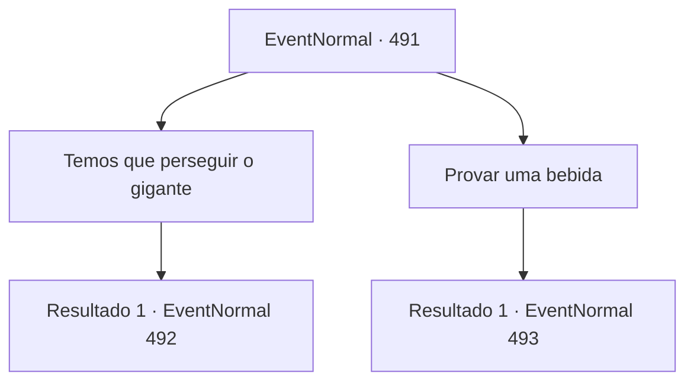

# Eventos normais · 491

[Índice da tabela](index.md) · [Índice geral](../index.md)

ID: `pt:EventNormal:491` · Fonte: `EventNormal4` · Versão: 1.2.47.

Mapeamento estático dos arquivos; a disponibilidade e a execução dependem do estado da run.

## Texto do evento

*Sem texto no arquivo.*

## Dados de entrada

```json
{
  "id": 491,
  "grade": 1,
  "place": "",
  "required": ""
}
```

## Mapa das escolhas



## Escolhas e resultados

### Escolha 1

Temos que perseguir o gigante

Requisitos e outros campos da escolha:

```json
{
  "required": ""
}
```

#### Resultado 1.1

Você transmitiu as palavras da mulher de meia-idade de que o gigante não deveria ser permitido na vila. Nesse momento, o velho ficou furioso e disse: 

 "Então! Você quer que eu morra de fome, é isso? Não se meta se não vai se responsabilizar por nada. Não ouse falar nada até que você tenha enfiado sujeira nos meus olhos."


Continuação registrada: [Evento 492](0492.md) na mesma tabela.

```json
{
  "required": "",
  "chance": "1",
  "nextEvent": 492,
  "type": 2,
  "reward": ""
}
```

### Escolha 2

Provar uma bebida

Requisitos e outros campos da escolha:

```json
{
  "required": ""
}
```

#### Resultado 2.1

Você entrou na casa do velho e provou a bebida que ele havia feito. Parecia ser uma bebida comum, mas tinha um sabor suave e um aroma excelente, algo que não se encontrava em outros bares. 

 "Vamos, mais uma dose"

 Você e o velho continuaram a beber juntos, desfrutando da companhia um do outro. O tempo passou rapidamente e logo o sol começou a se pôr no horizonte. Nesse momento, alguém bateu na porta. 

 "Terminado, mestre, disse a pessoa do outro lado."

 O velho se levantou apoiado em sua bengala, pegou uma garrafa de bebida e abriu a porta. Na porta estava o gigante de antes. 

 "Bem, você trabalhou duro. Sente-se aqui. Venha também"

 disse o velho, apontando para o lugar no pátio. O velho e o gigante se sentaram no chão do pátio e começaram a beber, e você também se juntou a eles. Após algum tempo, quando o clima estava descontraído, o velho solta uma pergunta: 

 "E você... ainda acha que 'Turanta' precisa ser expulso?"


Continuação registrada: [Evento 493](0493.md) na mesma tabela.

```json
{
  "required": "",
  "chance": "1",
  "nextEvent": 493,
  "type": 2,
  "reward": "0_1_1"
}
```

## Referências que chegam a este evento

- [Evento 490 · escolha 1 · resultado 1](0490.md#escolha-1)
