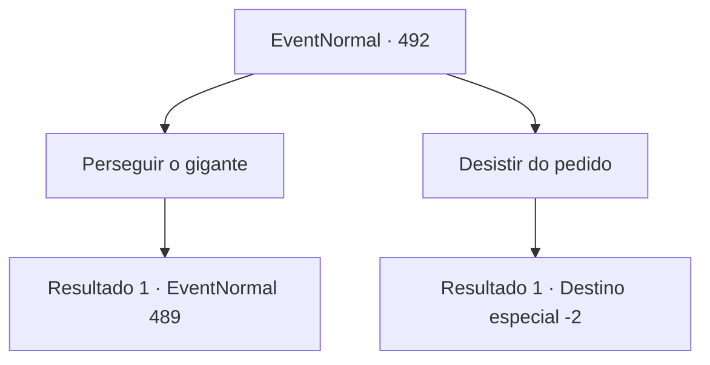

# Eventos normais · 492

[Índice da tabela](index.md) · [Índice geral](../index.md)

ID: `pt:EventNormal:492` · Fonte: `EventNormal4` · Versão: 1.2.47.

Mapeamento estático dos arquivos; a disponibilidade e a execução dependem do estado da run.

## Texto do evento

*Sem texto no arquivo.*

## Dados de entrada

```json
{
  "id": 492,
  "grade": 1,
  "place": "",
  "required": ""
}
```

## Mapa das escolhas



## Escolhas e resultados

### Escolha 1

Perseguir o gigante

Requisitos e outros campos da escolha:

```json
{
  "required": ""
}
```

#### Resultado 1.1

Eu entendo que você decidiu expulsar o gigante. Apesar da objeção do velho, ele não conseguiu acompanhá-lo com seus passos. Ao retornar ao campo de aveia, você atacou o gigante que estava guardando o campo. O gigante ficou muito excitado e balançou o porrete. 

 "Quem você pensa que é? A pessoa que deve sair é você. Saia imediatamente do campo!"


Continuação registrada: [Evento 489](0489.md) na mesma tabela.

```json
{
  "required": "",
  "chance": "1",
  "nextEvent": 489,
  "type": 2,
  "reward": "6_0_132",
  "place": 0
}
```

### Escolha 2

Desistir do pedido

Requisitos e outros campos da escolha:

```json
{
  "required": ""
}
```

#### Resultado 2.1

Você decidiu respeitar o relacionamento entre o gigante e o velho. O velho expressou sua gratidão por você entender e lhe ofereceu a bebida que ele havia feito. Aceitando o aromático licor, você deixou a vila.

Continuação registrada: [Destino especial `-2`](../destinos-especiais.md).

```json
{
  "required": "",
  "chance": "1",
  "nextEvent": -2,
  "type": 2,
  "reward": "5_438_9|3_256_1"
}
```

## Referências que chegam a este evento

- [Evento 491 · escolha 1 · resultado 1](0491.md#escolha-1)
