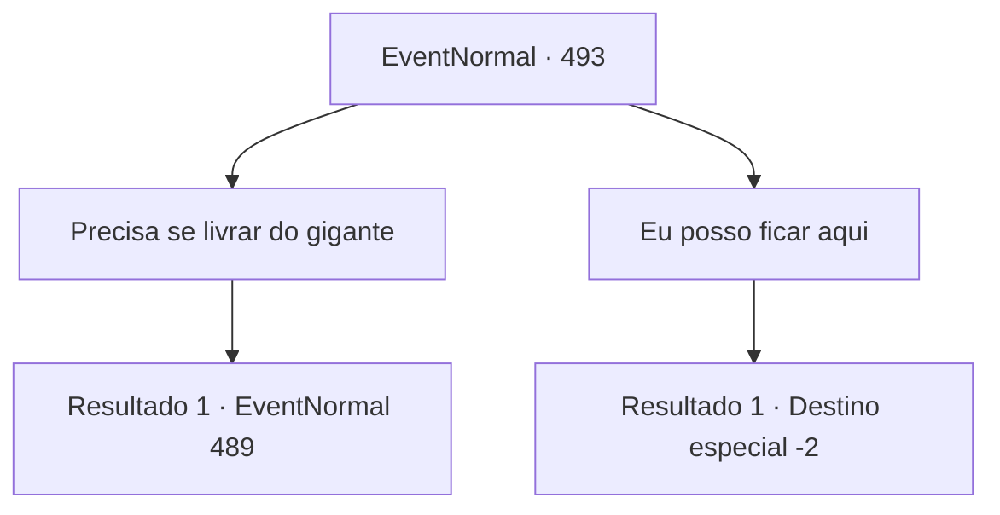

# Eventos normais · 493

[Índice da tabela](index.md) · [Índice geral](../index.md)

ID: `pt:EventNormal:493` · Fonte: `EventNormal4` · Versão: 1.2.47.

Mapeamento estático dos arquivos; a disponibilidade e a execução dependem do estado da run.

## Texto do evento

*Sem texto no arquivo.*

## Dados de entrada

```json
{
  "id": 493,
  "grade": 1,
  "place": "",
  "required": ""
}
```

## Mapa das escolhas



## Escolhas e resultados

### Escolha 1

Precisa se livrar do gigante

Requisitos e outros campos da escolha:

```json
{
  "required": ""
}
```

#### Resultado 1.1

Você disse que, de qualquer forma, o gigante precisava sair da vila. O velho franziu a testa e respondeu rudemente: 

 "Então mate-me se é isso que você quer! Se 'Turanta' não estiver aqui, vou morrer de fome e terminar essa vida que não tem muito tempo restante!"

 Com raiva crescente, o rosto do gigante ficou vermelho enquanto ele erguia o porrete e se levantava. 

 "Hmph... você que se vá!"

 O gigante, completamente excitado, balançou o porrete.

Continuação registrada: [Evento 489](0489.md) na mesma tabela.

```json
{
  "required": "",
  "chance": "1",
  "nextEvent": 489,
  "type": 2,
  "reward": "6_0_132",
  "place": 0
}
```

### Escolha 2

Eu posso ficar aqui

Requisitos e outros campos da escolha:

```json
{
  "required": ""
}
```

#### Resultado 2.1

Você decidiu respeitar o relacionamento entre o gigante e o velho. O velho agradeceu por sua compreensão e lhe ofereceu a bebida que ele havia feito. Você aceitou o licor aromático e deixou a vila.

Continuação registrada: [Destino especial `-2`](../destinos-especiais.md).

```json
{
  "required": "",
  "chance": "1",
  "nextEvent": -2,
  "type": 2,
  "reward": "5_438_9|3_256_1"
}
```

## Referências que chegam a este evento

- [Evento 491 · escolha 2 · resultado 1](0491.md#escolha-2)
