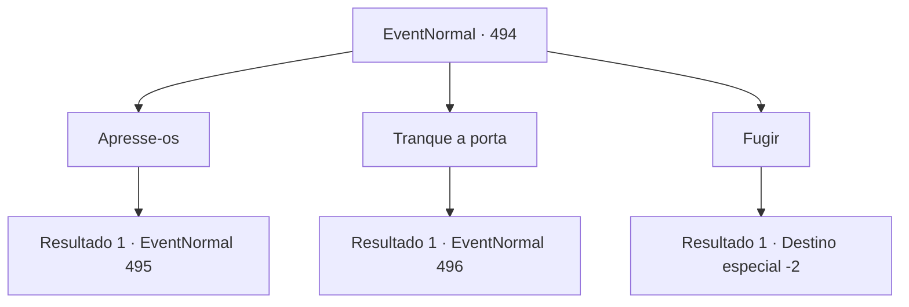

# Eventos normais · 494

[Índice da tabela](index.md) · [Índice geral](../index.md)

ID: `pt:EventNormal:494` · Fonte: `EventNormal4` · Versão: 1.2.47.

Mapeamento estático dos arquivos; a disponibilidade e a execução dependem do estado da run.

## Texto do evento

Você decidiu visitar a pousada da vila por um momento para escapar do vento. No entanto, de repente, gritos e vozes desagradáveis ecoaram pela vila. 

 "Kya kya kya! Mate todos eles!"

 Quando você olhou pela janela, viu uma horda de goblins emergindo das sombras. Eles estavam incendiando a vila, atacando as pessoas e saqueando suprimentos.

## Dados de entrada

```json
{
  "id": 494,
  "grade": 1,
  "place": "",
  "required": "5_474_0"
}
```

## Mapa das escolhas



## Escolhas e resultados

### Escolha 1

Apresse-os

Requisitos e outros campos da escolha:

```json
{
  "required": ""
}
```

#### Resultado 1.1

Você saiu correndo do estalajadeiro com uma arma em mãos. Nesse momento, os goblins que estavam atacando a vila partiram para cima de você. 

 "Uoooh! Morra!!"

 O primeiro a se aproximar foi um tipo de goblin chamado Bugbear. O enorme porrete do Bugbear veio em sua direção, prestes a desferir um golpe.

Continuação registrada: [Evento 495](0495.md) na mesma tabela.

```json
{
  "required": "",
  "chance": "1",
  "nextEvent": 495,
  "type": 2,
  "reward": "6_3_144",
  "place": 4
}
```

### Escolha 2

Tranque a porta

Requisitos e outros campos da escolha:

```json
{
  "required": ""
}
```

#### Resultado 2.1

Você tranca a porta e espera que os ataques dos goblins passem.

 No dia seguinte, você abre a porta da estalagem e sai cuidadosamente. A horda de goblins se foi, mas a cidade está em caos. Edifícios queimados e corpos macabros por toda parte contam os horrores da noite passada. 

 "Aventureiro! Por favor, me ajude! Os goblins levaram minha neta!"

 Um homem mais velho grita enquanto agarra você. Ele está tão desesperado que seu braço, preso, dói.

Continuação registrada: [Evento 496](0496.md) na mesma tabela.

```json
{
  "required": "",
  "chance": "1",
  "nextEvent": 496,
  "type": 2,
  "reward": ""
}
```

### Escolha 3

Fugir

Requisitos e outros campos da escolha:

```json
{
  "required": ""
}
```

#### Resultado 3.1

Você aproveitou a confusão na vila para escapar pela porta dos fundos da estalagem. Mesmo depois de ter corrido por um bom tempo, ainda podia sentir o cheiro acre da fumaça no ar.

Continuação registrada: [Destino especial `-2`](../destinos-especiais.md).

```json
{
  "required": "",
  "chance": "1",
  "nextEvent": -2,
  "type": 2,
  "reward": "5_474_10"
}
```

## Referências que chegam a este evento

Nenhum `nextEvent` positivo da mesma tabela aponta para este nó. Isso não prova que seja inacessível: sorteio e estado de história podem selecioná-lo.

