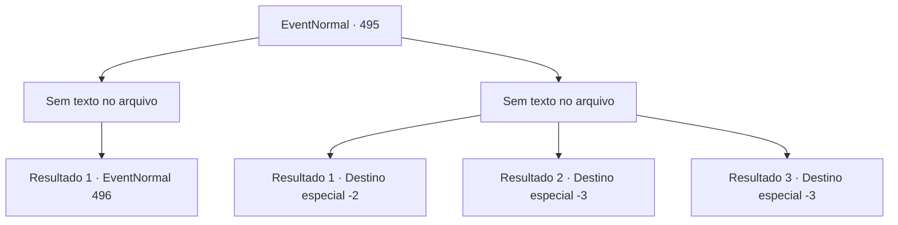

# Eventos normais · 495

[Índice da tabela](index.md) · [Índice geral](../index.md)

ID: `pt:EventNormal:495` · Fonte: `EventNormal4` · Versão: 1.2.47.

Mapeamento estático dos arquivos; a disponibilidade e a execução dependem do estado da run.

## Texto do evento

*Sem texto no arquivo.*

## Dados de entrada

```json
{
  "id": 495,
  "grade": 1,
  "place": "",
  "required": ""
}
```

## Mapa das escolhas



## Escolhas e resultados

### Escolha 1

*Sem texto no arquivo; o papel dessa opção depende da interface do jogo.*

Requisitos e outros campos da escolha:

```json
{
  "required": ""
}
```

#### Resultado 1.1

 Quando você finalmente derrota o Bugbear e os goblins que vieram até você, a manhã chega. Os goblins, gravemente feridos, recuam ao nascer do sol. Mas a vila já está um caos. Edifícios severamente queimados e corpos estão espalhados por toda parte na vila. 

 "Aventureiro! Por favor, me ajude! Os goblins levaram minha neta!"

 Um homem mais velho grita enquanto agarra você. Ele está tão desesperado que seu braço, preso, dói.

Continuação registrada: [Evento 496](0496.md) na mesma tabela.

```json
{
  "required": "",
  "chance": "1",
  "nextEvent": 496,
  "type": 2,
  "reward": ""
}
```

### Escolha 2

*Sem texto no arquivo; o papel dessa opção depende da interface do jogo.*

Requisitos e outros campos da escolha:

```json
{
  "required": ""
}
```

#### Resultado 2.1

Diante da violenta combinação do feroz Bugbear com os goblins, você sentiu sua situação se tornar sombria. Percebendo o perigo iminente, você rapidamente virou as costas e fugiu. Enquanto corria, você podia ouvir as risadas zombeteiras do grupo de goblins atrás de você.

Continuação registrada: [Destino especial `-2`](../destinos-especiais.md).

```json
{
  "required": "1_0_2|1_1_2",
  "chance": "1",
  "nextEvent": -2,
  "type": 2,
  "reward": "0_0_-1|0_1_-1|5_474_10"
}
```

#### Resultado 2.2

O porrete desferido pelo Bugbear atingiu sua nuca. Com um som estrondoso de algo se quebrando, o mundo se tingiu de vermelho intenso.

Continuação registrada: [Destino especial `-3`](../destinos-especiais.md).

```json
{
  "required": "2_0_2",
  "chance": "1",
  "nextEvent": -3,
  "type": 2,
  "reward": "0_0_-1|0_1_-1"
}
```

#### Resultado 2.3

O porrete desferido pelo Bugbear atingiu sua nuca. Com um som estrondoso de algo se quebrando, o mundo ficou totalmente vermelho.

Continuação registrada: [Destino especial `-3`](../destinos-especiais.md).

```json
{
  "required": "2_1_2",
  "chance": "1",
  "nextEvent": -3,
  "type": 2,
  "reward": "0_0_-1|0_1_-1"
}
```

## Referências que chegam a este evento

- [Evento 494 · escolha 1 · resultado 1](0494.md#escolha-1)
