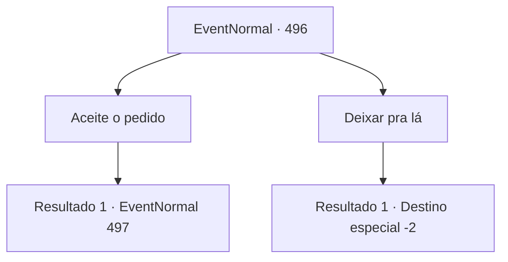

# Eventos normais · 496

[Índice da tabela](index.md) · [Índice geral](../index.md)

ID: `pt:EventNormal:496` · Fonte: `EventNormal4` · Versão: 1.2.47.

Mapeamento estático dos arquivos; a disponibilidade e a execução dependem do estado da run.

## Texto do evento

*Sem texto no arquivo.*

## Dados de entrada

```json
{
  "id": 496,
  "grade": 1,
  "place": "",
  "required": ""
}
```

## Mapa das escolhas



## Escolhas e resultados

### Escolha 1

Aceite o pedido

Requisitos e outros campos da escolha:

```json
{
  "required": ""
}
```

#### Resultado 1.1

Você aceitou o pedido do velho e partiu da vila. Seguindo as pegadas deixadas pelo grupo de goblins, você descobriu que estavam se dirigindo a uma montanha não muito distante da vila. Você seguiu as pegadas em direção à montanha, onde a vegetação densa proporcionava um ambiente propício para os goblins. Após algum tempo, você parou ao se deparar com um rio à sua frente. As pegadas do grupo de goblins terminavam no rio.

Continuação registrada: [Evento 497](0497.md) na mesma tabela.

```json
{
  "required": "",
  "chance": "1",
  "nextEvent": 497,
  "type": 2,
  "reward": ""
}
```

### Escolha 2

Deixar pra lá

Requisitos e outros campos da escolha:

```json
{
  "required": ""
}
```

#### Resultado 2.1

Você se soltou do aperto do braço do velho e deixou a vila.

Continuação registrada: [Destino especial `-2`](../destinos-especiais.md).

```json
{
  "required": "",
  "chance": "1",
  "nextEvent": -2,
  "type": 2,
  "reward": "5_474_10"
}
```

## Referências que chegam a este evento

- [Evento 494 · escolha 2 · resultado 1](0494.md#escolha-2)
- [Evento 495 · escolha 1 · resultado 1](0495.md#escolha-1)
