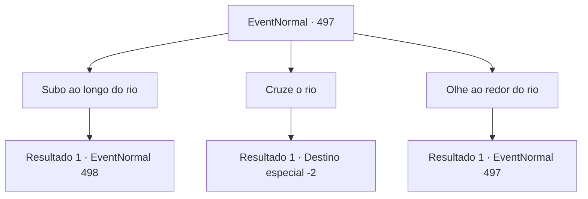

# Eventos normais · 497

[Índice da tabela](index.md) · [Índice geral](../index.md)

ID: `pt:EventNormal:497` · Fonte: `EventNormal4` · Versão: 1.2.47.

Mapeamento estático dos arquivos; a disponibilidade e a execução dependem do estado da run.

## Texto do evento

*Sem texto no arquivo.*

## Dados de entrada

```json
{
  "id": 497,
  "grade": 1,
  "place": "",
  "required": ""
}
```

## Mapa das escolhas



## Escolhas e resultados

### Escolha 1

Subo ao longo do rio

Requisitos e outros campos da escolha:

```json
{
  "required": ""
}
```

#### Resultado 1.1

Você seguiu o rio rio acima e, depois de trinta minutos, encontrou um grupo de goblins reunidos em frente a uma caverna. Eles estavam se divertindo, bebendo e fazendo barulho. Alguns cantavam, dançavam e faziam barulho, enquanto outros estavam espalhados por perto, aparentemente dormindo. 

 "Ka-ka-ka-ka!!"

 O membro mais proeminente do grupo de goblins era o xamã goblin. Você se preparou para lutar, fixando seu olhar no xamã goblin.

Continuação registrada: [Evento 498](0498.md) na mesma tabela.

```json
{
  "required": "",
  "chance": "1",
  "nextEvent": 498,
  "type": 2,
  "reward": ""
}
```

### Escolha 2

Cruze o rio

Requisitos e outros campos da escolha:

```json
{
  "required": "18_475_1"
}
```

#### Resultado 2.1

Você atravessou o rio e seguiu em frente pelo outro lado. Após trinta minutos, percebeu que havia chegado a um local equivocado e parou. Não havia sinal do grupo de goblins que você estava procurando, apenas uma vasta plantação de juncos à vista. Perdido entre os juncos, você acabou desistindo da missão.

Continuação registrada: [Destino especial `-2`](../destinos-especiais.md).

```json
{
  "required": "",
  "chance": "1",
  "nextEvent": -2,
  "type": 2,
  "reward": "5_474_10"
}
```

### Escolha 3

Olhe ao redor do rio

Requisitos e outros campos da escolha:

```json
{
  "required": "1_14_11|5_475_0"
}
```

#### Resultado 3.1

Você explorou as proximidades do rio e descobriu pegadas de goblins no fundo do rio. As pegadas indicavam que os goblins estavam seguindo rio acima. Parecia que os goblins, depois de atacarem a vila, entraram no rio provavelmente para se refrescar ou lavar-se.

Continuação registrada: [Evento 497](0497.md) na mesma tabela.

```json
{
  "required": "",
  "chance": "1",
  "nextEvent": 497,
  "type": 2,
  "reward": "5_475_1"
}
```

## Referências que chegam a este evento

- [Evento 496 · escolha 1 · resultado 1](0496.md#escolha-1)
- [Evento 497 · escolha 3 · resultado 1](0497.md#escolha-3)
