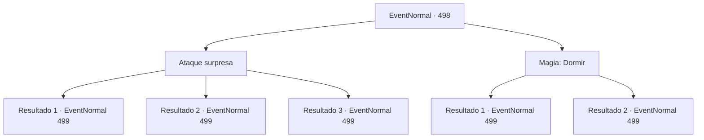

# Eventos normais · 498

[Índice da tabela](index.md) · [Índice geral](../index.md)

ID: `pt:EventNormal:498` · Fonte: `EventNormal4` · Versão: 1.2.47.

Mapeamento estático dos arquivos; a disponibilidade e a execução dependem do estado da run.

## Texto do evento

*Sem texto no arquivo.*

## Dados de entrada

```json
{
  "id": 498,
  "grade": 1,
  "place": "",
  "required": ""
}
```

## Mapa das escolhas



## Escolhas e resultados

### Escolha 1

Ataque surpresa

Requisitos e outros campos da escolha:

```json
{
  "required": ""
}
```

#### Resultado 1.1

Você surpreendeu o grupo de goblins que estava se divertindo e os atacou. Alguns goblins foram mortos de forma inesperada com seu ataque repentino, enquanto outros goblins ficaram confusos e começaram a fugir. 

 "Você, humano! Mate-o!"

 O xamã goblin liderou o restante do grupo de goblins que ainda estava presente e avançou em sua direção, pronto para lutar.

Continuação registrada: [Evento 499](0499.md) na mesma tabela.

```json
{
  "required": "21_5_1",
  "chance": "1|0_6_1",
  "nextEvent": 499,
  "type": 0,
  "reward": "6_2_23",
  "place": 1
}
```

#### Resultado 1.2

Você tentou surpreender o grupo de goblins que estava se divertindo, mas o xamã goblin percebeu sua presença e rapidamente gritou, arruinando sua tentativa de surpresa. 

 "Você, humano! Mate-o!"

 O xamã goblin liderou o grupo de goblins em um ataque direto contra você.

Continuação registrada: [Evento 499](0499.md) na mesma tabela.

```json
{
  "required": "21_5_1",
  "chance": "11",
  "nextEvent": 499,
  "type": 1,
  "reward": "6_0_23",
  "place": 1
}
```

#### Resultado 1.3

Você surpreendeu o grupo de goblins que estava se divertindo e os atacou. Alguns goblins foram mortos em seu ataque repentino, enquanto outros ficaram confusos e começaram a fugir. 

 "Você, humano! Mate-o!"

 O xamã goblin liderou o restante do grupo de goblins que ainda estava presente e avançou em sua direção, prontos para lutar.

Continuação registrada: [Evento 499](0499.md) na mesma tabela.

```json
{
  "required": "20_5_1",
  "chance": "1",
  "nextEvent": 499,
  "type": 2,
  "reward": "6_2_23",
  "place": 1
}
```

### Escolha 2

Magia: Dormir

Requisitos e outros campos da escolha:

```json
{
  "required": "20_0_2"
}
```

#### Resultado 2.1

Você lançou um feitiço de sono em direção ao grupo de goblins que estava se divertindo. O xamã goblin, percebendo tarde demais, gritou, mas mais da metade dos goblins já estavam mergulhados em um sono profundo. 

 "Você, humano! Mate-o!"

 O xamã goblin liderou o restante do grupo de goblins que não havia sido afetado pelo feitiço e avançou em sua direção. Você balançou sua arma em direção ao xamã goblin, que estava se aproximando rapidamente.

Continuação registrada: [Evento 499](0499.md) na mesma tabela.

```json
{
  "required": "",
  "chance": "1|0_7_1|0_12_1",
  "nextEvent": 499,
  "type": 0,
  "reward": "6_2_23",
  "place": 1
}
```

#### Resultado 2.2

O horrível som da canção dos goblins perturbou seu feitiço, fazendo com que você perdesse completamente sua concentração. Desistindo de lançar o feitiço, você avançou corajosamente em direção aos goblins. 

 "Você, humano! Mate-o!"

 O xamã goblin liderou o grupo de goblins em um ataque direto contra você.

Continuação registrada: [Evento 499](0499.md) na mesma tabela.

```json
{
  "required": "",
  "chance": "22",
  "nextEvent": 499,
  "type": 1,
  "reward": "6_0_23",
  "place": 1
}
```

## Referências que chegam a este evento

- [Evento 497 · escolha 1 · resultado 1](0497.md#escolha-1)
