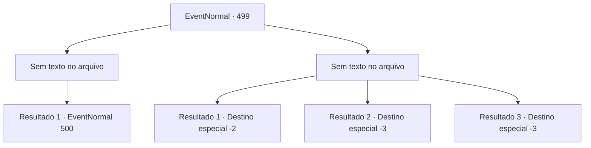

# Eventos normais · 499

[Índice da tabela](index.md) · [Índice geral](../index.md)

ID: `pt:EventNormal:499` · Fonte: `EventNormal4` · Versão: 1.2.47.

Mapeamento estático dos arquivos; a disponibilidade e a execução dependem do estado da run.

## Texto do evento

*Sem texto no arquivo.*

## Dados de entrada

```json
{
  "id": 499,
  "grade": 1,
  "place": "",
  "required": ""
}
```

## Mapa das escolhas



## Escolhas e resultados

### Escolha 1

*Sem texto no arquivo; o papel dessa opção depende da interface do jogo.*

Requisitos e outros campos da escolha:

```json
{
  "required": ""
}
```

#### Resultado 1.1

Você limpou o sangue de sua arma e olhou para o único inimigo restante. O assustado xamã goblin estava fugindo em direção à caverna. Decidindo segui-lo, você adentrou a caverna. A caverna era estreita e úmida, aparentemente um ponto de refúgio utilizado pelos goblins. Estava escuro e úmido lá dentro. Você acelerou o passo, perseguindo o xamã goblin que estava fugindo. Foi quando, de algum lugar da caverna, uma voz de uma menina ecoou. 

 "P-por favor... me ajude..."

 O apelo de ajuda vinha de um lugar bastante próximo.

Continuação registrada: [Evento 500](0500.md) na mesma tabela.

```json
{
  "required": "",
  "chance": "1",
  "nextEvent": 500,
  "type": 2,
  "reward": ""
}
```

### Escolha 2

*Sem texto no arquivo; o papel dessa opção depende da interface do jogo.*

Requisitos e outros campos da escolha:

```json
{
  "required": ""
}
```

#### Resultado 2.1

Você conseguiu escapar desesperadamente do grupo de goblins, enquanto eram perseguidos implacavelmente. Embora o xamã goblin estivesse liderando o ataque, felizmente a perseguição não durou muito tempo. Você conseguiu deixá-los para trás e escapar com sucesso.

Continuação registrada: [Destino especial `-2`](../destinos-especiais.md).

```json
{
  "required": "1_0_2|1_1_2",
  "chance": "1",
  "nextEvent": -2,
  "type": 2,
  "reward": "0_0_-1|0_1_-1|5_474_10"
}
```

#### Resultado 2.2

Um xamã goblin cavalga em cima de você que caiu. Então o duende xamã sorriu alegremente e balançou seu cajado em você. A terrível violência continuou até você morrer.

Continuação registrada: [Destino especial `-3`](../destinos-especiais.md).

```json
{
  "required": "2_0_2",
  "chance": "1",
  "nextEvent": -3,
  "type": 2,
  "reward": "0_0_-1|0_1_-1"
}
```

#### Resultado 2.3

Um xamã goblin cavalga em cima de você que caiu. Então o duende xamã sorriu alegremente e balançou seu cajado em você. A terrível violência continuou até você morrer.

Continuação registrada: [Destino especial `-3`](../destinos-especiais.md).

```json
{
  "required": "2_1_2",
  "chance": "1",
  "nextEvent": -3,
  "type": 2,
  "reward": "0_0_-1|0_1_-1"
}
```

## Referências que chegam a este evento

- [Evento 498 · escolha 1 · resultado 1](0498.md#escolha-1)
- [Evento 498 · escolha 1 · resultado 2](0498.md#escolha-1)
- [Evento 498 · escolha 1 · resultado 3](0498.md#escolha-1)
- [Evento 498 · escolha 2 · resultado 1](0498.md#escolha-2)
- [Evento 498 · escolha 2 · resultado 2](0498.md#escolha-2)
